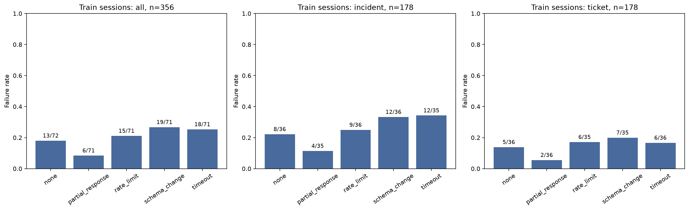
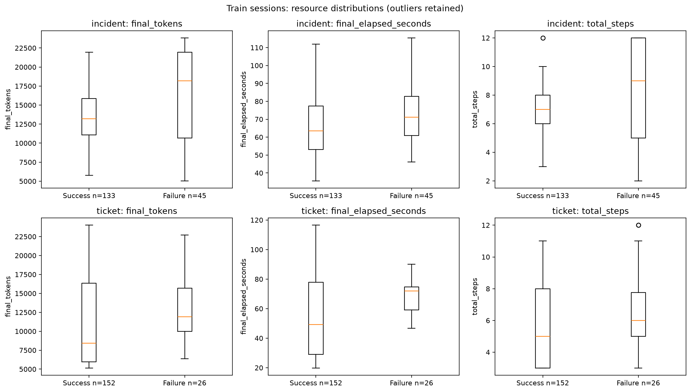
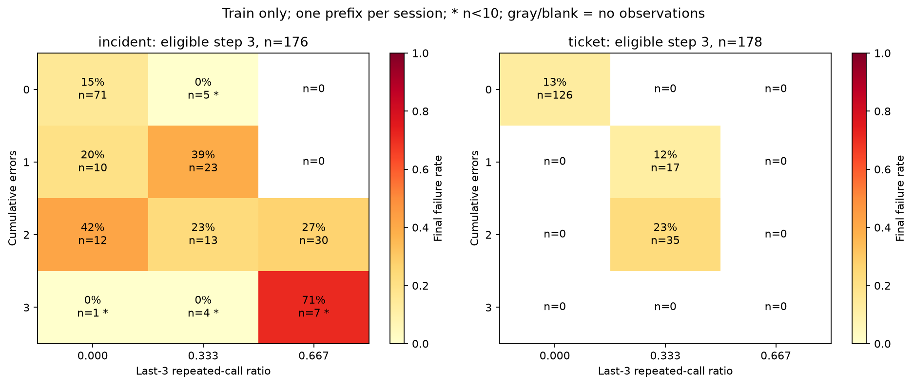
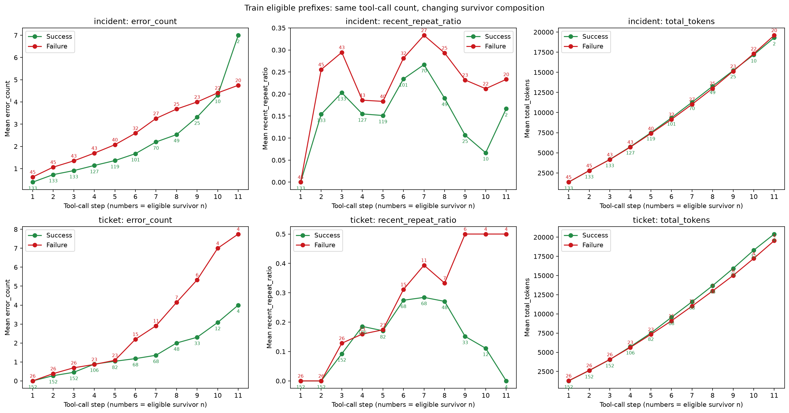
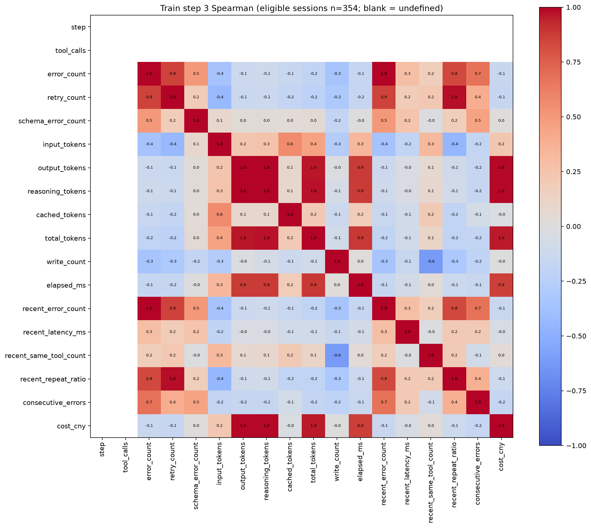

# AgentSentinel-Lite 正式采集 EDA v1

本报告由真实离线数据生成；未调用 API、未读取真实 .env、未训练任何模型。主数据来自 `data/authorized_20261025_30plus600_v1/collection`，pilot 不混入。proposal 的“尚未采集”为计划时表述，本报告给出采集后的结果。全部探索图、恢复分析、相关性和特征描述仅使用训练分区；验证和测试仅做质量、数量和预先要求的标签比例核对。

## 样本与冻结分区

原始 600 Session，保留有效 593，排除 7；有效可继续前缀 4240。模板分区原样沿用 6/2/2，没有重新随机划分。训练 356 条，失败 71（19.94%）；第3步可继续样本 354 条，其中失败 69（19.49%）。每个固定步 Session 至多贡献一行。

| split | n | templates | instances | failures | failure_rate | successes | prefixes |
| --- | --- | --- | --- | --- | --- | --- | --- |
| test | 119 | 2 | 8 | 32 | 0.2689 | 87 | 850 |
| train | 356 | 6 | 24 | 71 | 0.1994 | 285 | 2315 |
| validation | 118 | 2 | 8 | 12 | 0.1017 | 106 | 1075 |

[Session表](sessions.csv) · [前缀表](prefixes.csv) · [冻结分区](split.json) · [模板分区](template_split.csv) · [分区数量](partition_summary.csv)

## 数据质量与变量口径

检查 471677 个事件，完整重复事件 0，异常 elapsed 时间 0，JSON 数值非有限项 0。600套四文件可解析，Session/condition ID 唯一，任务与设计指纹一致，工具步数连续且与 totals 相符。时间检查覆盖全部事件 elapsed_ms 的缺失、负值、非有限和倒退；created_at 验证 ISO 与时区，无法独立验证提供方时钟准确性。真实相同工具与参数再次调用共 1010 次（含无效Session），全部保留，不当作重复日志删除。本轮没有需要去重的事件。

Reasoning Token 缺失：有效 Session 0/593，前缀 0/4240，保留 NA 和 missing 标记；描述统计按非缺失计数，相关系数按成对完整记录，不填零、不插补。Reasoning 已包含在输出Token中，不再相加。USD前缀字段因本轮币种而全空，不代表免费；实际成本使用 `final_cost_cny` / `cost_cny`，单位人民币元，保留 provider usage 的估算口径。无效运行有 7 个未知 usage 请求，无法将其总支出当作零。

[质量汇总](quality.json) · [逐Session质量](quality_by_session.csv) · [全部字段缺失率](missing_values.csv) · [7条排除清单](excluded_sessions.csv) · [源文件hash](source_hashes.json)

| session_id | split | termination | unknown_usage_requests |
| --- | --- | --- | --- |
| 0ebc01d5d16c4efb875018bf302d660c | test | time_budget | 1 |
| 10885dfe88984d0b85997103e94fe02c | train | time_budget | 1 |
| 56449cf348ee47e3899bc69ea7a93501 | train | time_budget | 1 |
| 654a73c0867b4bd98188036f5811230e | validation | backend_error | 1 |
| 9b7ff4f6adf54b42a15d78754e7e072a | train | time_budget | 1 |
| b66f55c055d04f47989ce521c880419c | train | backend_error | 1 |
| cf6b9bc485164f458e9326f73f821a60 | validation | backend_error | 1 |

7条无效因基础设施或无法完整核算usage而排除，原始日志仍保留。失败标签来自验证器（完成条件及违规写操作），不以故障条件或终止原因代替。`first_violation_step` 缺失表示没有记录违规，不是需要补零的特征。

## 训练集分组描述与故障恢复

[完整分组描述](train_grouped_descriptive.csv) 按结果、工作流、故障及组合输出 n、失败数、失败率，以及11项数值的非缺失n、均值、中位数、样本标准差、Q1/Q3。标准差使用 ddof=1；单样本组保留NA。

| fault_kind | n | failures | failure_rate | triggered_n | recovered_n | recovery_rate | explicit_error_n | success_after_error_n | success_after_error_rate |
| --- | --- | --- | --- | --- | --- | --- | --- | --- | --- |
| none | 72 | 13 | 0.1806 | 0 | 0 | NA | 0 | 0 | NA |
| partial_response | 71 | 6 | 0.0845 | 42 | 37 | 0.8810 | 0 | 0 | NA |
| rate_limit | 71 | 15 | 0.2113 | 63 | 49 | 0.7778 | 63 | 49 | 0.7778 |
| schema_change | 71 | 19 | 0.2676 | 65 | 47 | 0.7231 | 65 | 47 | 0.7231 |
| timeout | 71 | 18 | 0.2535 | 67 | 49 | 0.7313 | 67 | 49 | 0.7313 |

柱上为失败数/有效n；[恢复统计](train_fault_recovery.csv) 同时区分“配置了故障”与“确实触发”。恢复定义为至少一次 `fault_injected` 且最终成功，分母为实际触发Session；另外列出有可见工具错误后成功的比例。故障注入信息只用于事后分组解释，不进入前缀特征。正常环境的恢复率无定义。

## 资源与任务长度

| workflow | label | final_tokens | final_elapsed_seconds | total_steps |
| --- | --- | --- | --- | --- |
| incident | 0 | 13186.0000 | 63.4821 | 7.0000 |
| incident | 1 | 18185.0000 | 71.1846 | 9.0000 |
| ticket | 0 | 8407.0000 | 49.1448 | 5.0000 |
| ticket | 1 | 11934.0000 | 71.9427 | 6.0000 |

label=0为成功，1为失败。箱图保留极端值，须在工作流内比较。已回查训练集Token和耗时各前5名对应原始结果与事件时序，未删除或截尾：[极端轨迹索引](train_extreme_sessions.csv)。完整Session消耗包含最后一轮模型调用，工具后前缀不含未来调用，两者不是同一观察时点。

## 第3步错误与重复调用

[每格统计](train_step3_heatmap_cells.csv) · [训练第3步样本](train_step3_prefixes.csv)

仅使用当时 `decision_eligible=true` 的第3次工具调用。重复程度为最近3次调用中 `(3-不同工具及规范化参数签名数)/3`，并非文本重复。星号格 n<10，空格 n=0；不合并工作流。最终标签只作事后比较，故障类别和未来总步数不作早期输入。可继续表示当时尚有预算并可进行下一次模型调用，不要求未来一定再调用工具，不借最终长度筛样本。

## 同步数前缀趋势与相关性

[趋势数据及存活n](train_prefix_trends.csv)。每个点比较相同工具调用数，数字是该结果组当时仍可继续的Session数。累计错误、最近重复比例、Token均只从当前及过去工具事件计算。晚期曲线的样本组成不同，不能把跨步均值变化解释成同一批任务的演化，更不能把多行前缀当独立Session。

[相关矩阵](train_step3_spearman.csv) · [成对样本数](train_step3_spearman_pair_n.csv)。矩阵不包含最终标签、故障配置或未来资源，使用人民币成本。常量或全缺失列 step, tool_calls 的相关性未定义，保留空格。固定第3步无法估计长度与其他变量的相关性；不同工作流混合后的相关性也可能反映任务组成。此处为描述，不据此训练或宣布特征选择结论。

## 截断、预算及结论边界

| termination | n | failures | failure_rate |
| --- | --- | --- | --- |
| completed | 285 | 2 | 0.0070 |
| output_truncated | 47 | 47 | 1.0000 |
| step_budget | 24 | 22 | 0.9167 |

[训练终止统计](train_termination.csv)。输出截断、12工具步/30000输入输出Token/120秒预算共同影响实际结局；本数据的“失败风险”是当前Agent和预算下的风险，不是任务永远无法完成。max_completion_tokens=1024 可造成模型输出截断。模拟超时和限流立即返回，耗时不代表真实网络故障等待。因早期终止而未到第3步的任务不进入固定步图；达到预算的终末前缀也不作为预警点。长轨迹在前缀总表中行数更多且后期存活者往往更困难，存在生存偏差。

数据仅6个训练模板（每工作流3个），同模板的实例、故障条件和重复运行相关；不把593 Session或数千前缀视为同量独立任务。稀疏格和故障小组比例不稳定，没有进行显著性检验或因果推断。测试仅两个冻结模板，不能据本EDA断言泛化或在线节省。未探索测试特征、未调整分区、未训练模型。

## 复现与验证

在项目根目录直接运行 `.venv/bin/python artifacts/eda_v1/reproduce.py artifacts/eda_v1_recheck` 可在新的空输出目录复现（不经过会读.env的CLI）。默认输出本目录，若已有产物会拒绝覆盖。脚本只导入离线FeatureBuilder、设计验证与JSON函数，不加载Settings.from_env或后端。

[复现脚本](reproduce.py) · [核验结果](validation.json) · [训练摘要](training_summary.json)。全部 2400 个源文件分析前后SHA256一致，表行数和冻结分区核对通过，5张PNG可解码。未修改源数据、分区或执行git提交。
