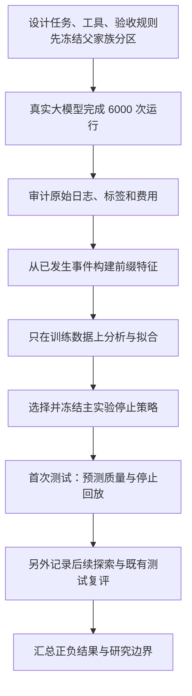

# AgentSentinel-Lite：给合作者的项目说明与讲解稿

适合第一次接触项目的合作者阅读，不要求预先了解 Agent 或机器学习。更新：2026-11-06。
本文只介绍 6,000 次采集这一批研究；完整结果以[最终研究报告](RESEARCH_REPORT_6000_FINAL.md)为准。

## 先用一分钟了解我们做了什么

我们研究的是：**当 AI 正在调用工具完成一项任务时，能否根据它已经做过的事情，
提前判断这项任务最后会不会失败，并在适当的时候停止，减少后续开销？**

为此，我们搭建了一个模拟服务台，让真实大模型处理工单和服务事件，采集了 6,000 次任务运行。
然后从运行日志中提取错误、重试、写入次数、Token 消耗等信号，训练轻量的风险预测模型，
并用已保存的轨迹评估提前停止会带来多少节省、多少误伤。

目前的结果是：这些信号确实能帮助识别失败，停止也能节省一部分后续开销；
但有些原本能够成功的任务会被提前停止，而且多数告警来不及阻止第一次违规写入。
因此，本阶段完成的是一项有正面结果、也明确揭示局限的研究，当前运行入口默认只预测。

阅读正文可以了解整个项目；开会时可直接使用文末的讲解顺序与五分钟讲稿。

## 1. 为什么需要研究这个问题

普通聊天主要输出文字。Agent 则可以根据用户目标，反复决定下一步做什么，并调用工具执行。
例如，它可能先查一张工单，再查相关服务状态，读取处理规则，最后修改记录。

执行过程中，每一次大模型请求都会消耗 Token 和时间。Token 可以粗略理解为模型处理文本的计量单位，
输入和输出通常都要付费。如果 Agent 已经偏离目标却继续运行，后续消耗可能没有价值。
但如果一遇到错误就停，又会中断那些经过重试本来能成功的任务。

这里有两个需要同时考虑的目标：

- 尽早识别最后会失败的任务，减少继续执行的资源消耗。
- 尽量保留原本能成功的任务，避免为了省钱而把事情做坏。

我们希望通过实验测清楚这两者的关系，而不是只报一个分类准确率或节省比例。

## 2. 用一个任务理解系统里的三个角色

下面是用于讲解的简化任务，**不是实验中的一条实测记录**：

> 查询服务状态和处理策略，按要求记录服务事件，并给相关工单追加备注。
> 任务没有要求修改工单状态。

Agent 可能这样执行：

| 工具步骤 | Agent 做什么 | 这一步可能出现的问题 |
| --- | --- | --- |
| 1 | 读取工单 | 没有找对关联服务 |
| 2 | 查询服务状态 | 工具返回超时 |
| 3 | 重试查询，拿到状态 | 重试成功，可以继续 |
| 4 | 查询处理策略 | 返回内容可能缺少必要字段 |
| 5 | 记录事件 | 可能记录错对象，或做了任务未要求的操作 |
| 6 | 追加工单备注 | 必要操作可能至此全部完成 |

本项目里有三个不同的角色：

| 角色 | 使用什么实现 | 负责什么 |
| --- | --- | --- |
| 执行者：Agent | 真实大模型 `kimi-k3-1-pro-261024` | 理解任务、选择工具、组织工具参数、继续执行或结束 |
| 观察者：风险预测器 | 本地训练的 LR 等轻量模型 | 根据已经发生的工具事件，预测任务最终失败的风险 |
| 评分者：验证器 | 程序中写好的任务验收规则 | 检查必要操作、写入历史和最终状态，给出真实结果标签 |

**我们训练的是第二个角色，没有重新训练执行任务的大模型。**
验证器也不依赖另一个大模型主观打分。

以示例来说，第 2 步超时后，第 3 步成功恢复，任务仍可能完成。
如果 Agent 另外修改了不该修改的工单状态，即使工具返回“执行成功”，任务也可能验收失败。
所以“工具是否报错”和“业务任务是否成功”必须分别判断。

## 3. “每一步预测”具体是怎么回事

### 3.1 先理解任务、运行和前缀

同一个任务可以运行多次，每次大模型选择的路径可能不同。
一次从开始到结束的完整运行叫一个 **Session**，它保存了整条执行轨迹。

**前缀（Prefix）就是这条轨迹截至当前步骤的全部已知部分。**

| 当前时点 | 预测器能观察的内容 | 它此时不知道的内容 |
| --- | --- | --- |
| 第 1 步返回后 | 第 1 步及累计用量 | 第 2 步以后会发生什么 |
| 第 3 步返回后 | 第 1—3 步及累计用量 | 以后能否完成、是否会错误写入 |
| 第 6 步返回后 | 第 1—6 步及累计用量 | 后面是否还会破坏已经完成的结果 |

模型每次回答的都是同一个问题：

> 按这套 Agent 执行方式和预算继续运行，这个任务最后会成功还是失败？

### 3.2 学习时知道结局，实际预测时只看过去

训练时，我们已经有完整轨迹，因此知道每次运行最后是否成功。
可以把一条轨迹切成多个前缀，让模型学习“看到这样的过程，最后通常是什么结果”。

例如，一条运行先超时、再重试、最后成功，那么它的第 1、3、6 步前缀的监督答案都叫“最终成功”。
模型在第 3 步可以暂时判断风险较高，但不会因为当时发生超时，就把这条训练样本改成“最终失败”。

相反，一条最终失败的轨迹，即使前几步没有报错，前几步的监督答案仍是“最终失败”。
这会产生真正的预测难度：有些成功与失败任务的早期过程非常相似。

训练答案可以来自完整轨迹，**输入特征只能来自当前及过去**。
隐藏答案、未来事件和真实验收状态一旦混入输入，就相当于提前看了答案，分数会失去意义。

### 3.3 预测概率与停止决定是两件事

预测器输出一个概率；停止规则决定是否据此干预。

例如，后续探索采用“失败概率至少 90%，连续两步达到才停止”的规则。
第 5 步达到门槛、第 6 步降下去了，就不满足连续两步的条件。
该规则能减少对单次波动的反应，但也可能使告警更晚。

还要分清两个问题：

- **最终成功概率高：** 继续做下去可能成功。
- **当前已经达标：** 现在就结束，也已经满足任务验收。

它们不是一回事。不能因为预测“最后能成功”，就认为现在可以直接停止。

## 4. 数据从哪里来，6,000 条到底表示什么

### 4.1 真实模型操作模拟业务

我们用代码搭建了工单和服务事件两类任务环境，提供读取与写入工具。
业务对象、状态和操作规则是模拟的，不连接真实生产系统；
模型如何选择工具、是否重试、是否多做操作，则来自真实大模型运行。

采集设计为：

**20 个模板 × 每模板 20 个参数实例 × 5 种条件 × 3 次重复 = 6,000 次运行。**

这里的“模板”表示一种任务结构，“参数实例”是在该结构下更换具体对象和数值。
五种条件为正常、超时、限流、返回结构变化和部分响应。
重复运行用于观察同一设置下执行路径的差异。

因此，6,000 次运行不是 6,000 种完全不同的问题。
它们来自 400 个参数实例，20 个模板又归属于 10 个父任务家族。
父家族可以理解为共享一类基本解题结构的一组模板。

每次运行最多允许 12 次工具调用、24 次模型请求。
本批次未设置累计 Token 和整个 Session 的时间上限，单次输出长度使用供应商默认配置。
工具步骤与模型请求不是同一个计数：例如最终回复可以产生模型请求，却不调用工具。

### 4.2 故障条件不等于失败标签

设置工具故障，是为了观察 Agent 遇到困难后能否恢复。
分配到故障条件不保证实际触发故障，触发了也不一定最终失败。

还要区分两类异常：

| 异常 | 在研究中的处理 |
| --- | --- |
| 模拟读取工具返回超时等错误，任务过程仍完整记录 | 是我们要研究的执行困难，可以进入业务结果分析 |
| 调用大模型的网络或协议异常，使正常执行无法完整进行 | 单独标为基础设施无效，不直接当作业务失败训练 |

排除第二类记录，是为了避免把“模型服务没正常工作”混同于“Agent 业务决策失败”。
这些记录和已经产生的费用都仍然保留。

### 4.3 审计后的实际数据

| 数据用途 | 有效运行 | 最终成功 | 最终失败 | 父家族数 |
| --- | ---: | ---: | ---: | ---: |
| 训练：让模型学习 | 3,542 | 2,570 | 972 | 6 |
| 验证：选择主实验停止策略 | 1,176 | 997 | 179 | 2 |
| 测试：评价冻结方案 | 1,176 | 855 | 321 | 2 |
| 合计 | 5,894 | 4,422 | 1,472 | 10 |

6,000 次中有 106 次基础设施或协议无效；有效运行生成了 47,184 条可决策前缀。
前缀数更多，只是因为一条轨迹可以在多个步骤提供观察，不能把它们当作同样多的独立任务。
第 12 步不再产生新的停止决定，因为当步工具预算已经用完。

整批记录了 53,726 次模型请求，已知用量估算费用约 ¥1,006.60，
还有 103 次请求费用未知，不能把它们记成零。后续分析使用已有日志，没有新增收费请求。

## 5. 怎样定义成功，怎样保证评价可信

### 5.1 成功由任务验收决定

本项目的严格验收检查：

1. 该做的写入操作是否完成。
2. 最终业务状态是否符合要求。
3. 全部写入历史中，是否有多做、做错或重复的操作。

例如，要求“记录事件并追加备注”，Agent 却又改了工单状态，就可能失败。
即使它随后把状态改回来，历史违规也不能因此消失。
读取失败后重试恢复，则不必然破坏最终成功。

正常说出“已完成”并不保证通过验收；用完第 12 步也不一定失败，
因为最后一步可能恰好做完所有必要操作。

这个验收标准也有边界：它没有独立检查所有必要读取是否执行，也没有评价最终文字回复质量。
我们说的“成功”，始终限定在上述程序验收范围内。

### 5.2 为什么不随机打散所有前缀

假设同一任务的第 3 步被放进训练集，第 4 步被放进测试集。
模型实际上已经见过同一条轨迹的一部分，测试就会过于容易。
相似模板混在训练和测试中，也可能让模型只记住某类熟悉任务。

因此，分区在采集前就按父家族冻结。
同一家族的模板、实例、条件、重复运行及全部前缀都留在同一分区。
训练内部再进行分组交叉验证：轮流留出训练家族，检查模型对未参与当折拟合的家族表现如何。

### 5.3 为什么主实验与后续探索分开讲

主实验先确定方法，在训练集拟合、验证集选策略，冻结所有政策后才做首次测试。
这部分是报告的主要证据。

后续改进已经知道前面的实验结果，并重新使用了既有测试集进行复评。
即使复评前再次固定参数，它也不能重新变成一个从未看过的新测试集。
所以后续结果用于说明探索进展和局限，不能包装成另一轮全新的独立验证。

## 6. 我们实际完成了哪些工作

整个项目不只是训练了一个分类器，而是建立了从任务执行到结果复核的完整流程。

| 工作 | 解决了什么问题 |
| --- | --- |
| 任务环境与日志采集 | 让 Agent 真正运行，并保留每一步可以追溯的原始证据 |
| 全量数据审计 | 核对 24,000 个 Session 文件及控制文件，检查遗漏、异常、标签和费用 |
| 训练集探索分析（EDA） | 先弄清失败表现，避免凭直觉认定“报错多就是失败” |
| 特征与模型训练 | 从可观察事件提取信号，比较 LR、KNN 与规则 |
| 冻结策略与离线回放 | 同时统计失败告警、成功误停、费用及告警时机 |
| 消融和分组分析 | 删除某类特征、按任务家族分别统计，检查结果依赖哪些信息与任务 |
| 后续早期预测探索 | 增加调用历史和公开返回字段完整性，检查能否更早识别 |
| 报告与复核产物 | 保存方案、模型、逐任务结果和文件哈希，让合作者能够复查 |

训练分析发现了三个特别有解释力的现象：

- 2,570 次训练成功中，1,316 次出现过显式工具错误：报错后仍可能成功。
- 77 次训练成功直到第 12 步才达标：执行较长不等于无效执行。
- 80 次训练失败曾经达标，后来又额外写入而失败：完成之后继续做也可能破坏成果。

这解释了为什么“错误数达到某个值就停”或“到某一步就停”很难适用于所有任务。

## 7. 用什么模型，模型看见什么

### 7.1 为什么使用 LR 和几个简单对照

LR 是 Logistic Regression，即逻辑回归。它从数据中学习各个输入信号的权重，
组合后输出成功或失败概率。本项目选择它作为轻量、便于检查的主模型。

KNN 会参考特征空间中相近的历史样本；固定规则按预定义条件触发，
步数规则按执行长度触发；永不停止代表让原任务继续运行。
这些对照帮助我们判断：复杂一点的学习模型是否比简单限制更有用。

### 7.2 主实验的 22 列输入

可以先把它们理解为六类信号：

| 信号 | 通俗例子 |
| --- | --- |
| 执行进度 | 现在第几步，调用过多少次工具 |
| 错误与重试 | 报错几次，是否连续失败，是否重试 |
| 工具与写入阶段 | 刚用了哪个工具，前一个是什么，已经写过几次 |
| 最近行为 | 最近是否重复调用同一工具或同类操作 |
| 资源消耗 | 已用多少输入、输出、缓存和推理 Token，估算花了多少钱 |
| 时间 | 已经过多久，最近工具耗时如何 |

模型不会直接看到“当前还有两个必需操作没做”“这一步已经违规”或“后面还会花多少钱”这样的答案。
尤其是：观察到一次写入，不等于知道它是否符合隐藏验收要求。

### 7.3 如何选择停止门槛

主实验先要求：在验证集中，原成功任务被误停的比例不超过 5%；
然后在满足条件的候选门槛中，选择估算执行费用最低的策略。

这里的 **5% 是允许的验证误停比例**，不是“失败概率达到 5% 就停止”。
最终主 LR 选出的失败概率门槛约为 73.81%，首次达到就停止。
后续探索的“90%、连续两步”是另一套规则，不能混用。

固定规则和 KNN 在本次 5% 预算下选出的策略均不停止任何任务。
这说明它们在本次候选范围和选择方法下没有取得可用的停止收益，不代表所有规则都无效。

## 8. “离线回放”怎么计算效果

我们已经保存了一次任务完整运行的录像式记录。
离线回放就是从头按步骤读这份记录，每到一个允许决定的位置，就让冻结的模型与规则判断一次。

假设某条原轨迹在第 10 步结束，规则在第 6 步返回后触发停止：

- 第 1—6 步已经发生，费用和写入都保留。
- 第 6 步之后的原轨迹资源，被计为假设停止可以省下的部分。
- 用第 6 步时的状态和写入历史，检查停在这里是否通过验收。

这让我们能直接比较不同策略对同一批原始轨迹的影响。
但它是根据原始过程计算的估算，本批次没有实际执行在线停止对照，
也没有观察被停止后用户会如何处理或 Agent 会如何重新规划。

还必须问“提前于哪个时点”：

- **提前于原终止：** 原来第 10 步结束，第 6 步就发出了告警。
- **提前于首次违规：** 原来第 5 步第一次错误写入，必须在第 5 步之前告警才算预防。

如果第 6 步才发现风险，可以减少后续浪费，但第 5 步的错误已经发生。
我们在工具返回之后评分，所以无法通过当步告警撤销当步写入。

## 9. 主实验结果应该怎样解释

先记住测试分母：**1,176 次任务运行，原成功 855 次、原失败 321 次。**
其中 268 条含有违规，其余失败可以有缺必要操作等其他原因。

| 结果 | 数字 | 应怎样理解 |
| --- | ---: | --- |
| 最终失败中被告警的任务 | 267/321，83.18% | 能识别大部分最后失败的运行 |
| 原成功中被误停的任务 | 17/855，1.99% | 一些本来能成功的任务会被中断 |
| 估算费用节省 | 9.74%，约 ¥20.09 | 分母为全体测试轨迹约 ¥206.20 的费用 |
| 首次违规前告警 | 32/268，11.94% | 真正来得及预防首次违规的比例较低 |
| 停止后的严格回放成功数 | 841，原来为 855 | 本策略没有实现无损停止 |

841 的来源是：

**855 次原成功 − 17 次尚未完成就被停的成功 + 3 次停止保住了成果的原失败 = 841。**

后面这 3 次的意思是：原轨迹在某个时刻已经达标，后来又做坏了；
回放中如果在达标时停止，就能保住当时的结果。
这是对本地状态的估算，不是新做了一次在线实验。

节省的 ¥20.09 中，约 ¥18.04 来自原失败任务，约 ¥2.04 来自被误停的原成功任务。
因此，不能把全部节省都叫作“没有代价的优化”。

从预测本身看，主 LR 的全前缀 AUC 为 0.8413，高于 KNN 的 0.7749；
固定第 3 步 AUC 为 0.7422，说明较早时的区分能力更有限。
AUC 衡量的是风险排序能力，**0.8413 不等于有 84.13% 的任务预测正确**。

我们还检查了删除特征和不同任务家族的结果。主策略全部 17 次误停，
以及绝大部分节省，都来自 incident 家族。测试只有两个父家族，
所以不能用这一千多次重复运行宣称对各种任务都有效。

## 10. 后来为什么又做了一版早期预测

主实验的困难是：识别出不少失败，但有的判断偏晚，有的把可恢复任务误停了。
后续探索仍然使用 LR，尝试提供更具体的过程信息：

- 相同工具和参数被调用了多少次。
- 读取、写入和恢复的顺序是什么。
- 连续读取是否仍然缺少信息。
- 工具公开要求的返回字段是否缺失。

例如，工具返回 `ok`，但处理策略里没有 `action` 字段，
旧的错误计数可能看不出问题，新增特征可以记录这种信息不完整。
这些信息来自已经返回的数据和公开工具契约，不使用故障注入器的答案。

输入由 22 列扩展到 48 列。后续开发也试过辅助预测：
“现在是否通过验收”“继续执行还会花多少钱”“还会消耗多少 Token”。
主问题仍是整个任务最后能否通过原验收，辅助头没有改变最终成功标准。
当前验收和未来费用的真实值只在离线学习、评价时使用。

### 10.1 同一 90% 门槛下的比较

这里的“22 列对照”是探索阶段的 `frozen_v2`，**不是上一节的主实验 LR**。
它们的拟合选参和停止方案不同。下面两列才是这次同门槛比较的一对模型：

| 指标 | 探索对照：22 列 | 新版：48 列 |
| --- | ---: | ---: |
| 告警的原失败任务 | 237 | 237 |
| 误停的原成功任务 | 4 | 3 |
| 平均停止步骤 | 8.13 | 7.75 |
| 费用节省 | 5.39% | 5.83% |
| 第 6 步结束前失败告警 | 14 | 60 |
| 第 3 步结束前失败告警 | 0 | 0 |
| 首次违规前停止 | 4 | 5 |
| 严格成功净变化 | −4 | −3 |

两模型都要求失败概率至少 90%、连续两步确认。
还要求预测剩余费用至少为 0；由于该门槛为 0，目前没有证明费用预测头带来了额外收益。

这次改进可以准确地描述为：

> 在既有测试集和相同主门槛下，新版少误停了一个成功任务，
> 中期告警增加，费用多节省约 ¥0.91；仍会损失原本能成功的任务。

不能把“第 6 步前识别更多”说成“已经可靠地预测最早几步的失败”。
第 3 步结束前仍没有触发失败停止，首次违规前也只停止了 5 条。

更保守的 99% 门槛下，两模型本次都没有误停，但新版识别的失败更少；
80% 门槛下，新版识别更多失败，也多误停了成功任务。
新版全前缀 AUC 下降，验证集第 3 步的概率误差也变差，因此不能宣称全面优于对照。

### 10.2 一个真实误停案例

任务 `v2-incident-05-04` 的一条测试运行中，Agent 多次读取到不完整信息，
但显式工具错误数为 0，历史违规也为 0。

| 时点 | 新版模型预测最终成功概率 | 原轨迹发生了什么 |
| --- | ---: | --- |
| 第 7 步 | 9.01% | 首次达到 90% 失败门槛 |
| 第 8 步 | 2.34% | 连续第二步达到门槛，回放策略会停止 |
| 第 10 步 | 2.27% | 原轨迹随后获取完整策略 |
| 第 11 步 | 41.30% | 完成一个必要写入 |
| 第 12 步 | 不产生新决定 | 原轨迹最终通过严格验收 |

这个例子说明：模型有理由认为任务处境不好，但“很像失败”仍不等于“不会恢复”。
过于积极地停止，就会损失后面实际存在的成功路径。
完整 Session 为 `0e8b3d93fc1a4109bfdb2f1ee649c3ab`，可在[复评报告](EARLY_LR_TEST_RESULTS.md)中追溯。

## 11. 现在能下什么结论，项目完成到了哪里

本阶段已经完成环境、真实轨迹采集、数据审计、训练分析、模型对照、
停止回放、特征消融、后续探索及报告。数据、源码快照、模型和逐任务结果均可复核。
实现阶段已有 410 项回归测试通过；工程检查通过与研究目标达成是两件事。

现有证据支持：

- 结构化工具事件包含与最终失败有关的信息，轻量 LR 可以利用它们。
- 识别失败后停止，有机会减少后续执行开销。
- 成功保护、告警时机和节省之间存在明显取舍，不能只看单一指标。

目前还不能证明可靠预防第一次违规、无损自动停止，或提高真实在线完成率。
外部适用性也有限：数据只覆盖一个执行模型、两类模拟工作流，测试只有两个父家族。

因此，研究可以按现有结论交付，当前默认只预测。
如果以后单独研究自动干预，需要新的独立任务家族与评价方案；它不是本次定稿的前置任务。

## 12. 向合作者讲解时，建议按这个顺序

### 12.1 一次约 20 分钟的介绍

| 时间 | 讲什么 | 希望听众理解什么 |
| --- | --- | --- |
| 0—3 分钟 | 用第 2 节的任务讲清 Agent 如何操作工具 | AI 会采取动作，错误可能发生在中间过程 |
| 3—6 分钟 | 解释执行者、风险预测器、验证器，以及前缀 | 谁做任务、谁猜结局、谁给答案 |
| 6—9 分钟 | 说明 6,000 次采集、有效样本和按家族分区 | 数据从哪里来，为什么不能随意打散 |
| 9—13 分钟 | 展示主实验结果表和 855−17+3=841 | 节省与成功损失必须一起看 |
| 13—16 分钟 | 讲“第 8 步被停、第 12 步原本成功”的案例 | 为什么早停很难，改进解决了多少 |
| 16—20 分钟 | 说明当前结论、交付物与问题讨论 | 已完成研究，自动干预能力仍有限 |

第一次介绍时，先给大家建立任务与评价概念。
等大家理解结果的分母，再根据问题展开 AUC、选参、具体特征名和代码实现。

### 12.2 可以直接说的五分钟讲稿

> 我们这个项目叫 AgentSentinel-Lite，研究的是 AI Agent 执行任务时的失败预测。
>
> 这里的 Agent 会实际调用工具。比如用户要求它查询服务状态、读取处理规则，再记录事件和追加备注。
> 它可能遇到工具超时，也可能重试成功；还可能工具都执行成功了，却多改了一个不该改的字段，
> 最后仍然没有完成用户真正要求的任务。
>
> 我们想知道：能不能在执行过程中看出它最后可能失败，在适当的时候停止，
> 省下后面的调用费用，同时尽量不打断本来能成功的任务？
>
> 系统里有三个角色。真实大模型负责做任务，程序验证器负责检查最后是否达标，
> 我们训练的 LR 负责看过程、预测风险。我们没有重新训练做任务的大模型。
>
> 为了做实验，我们搭建了模拟工单和服务事件环境，让真实模型运行了六千次。
> 这里包含二十个模板、多种具体对象、五种正常或故障条件，以及重复运行。
> 经过审计，保留了五千八百九十四次有效运行。每条运行可以切成多个前缀，
> 比如只看前三步，就预测整个任务最后能不能成功。模型不能看到未来或者隐藏验收答案。
>
> 我们按任务家族区分训练、验证和测试，比较了逻辑回归、近邻模型和几类简单停止规则。
> 主模型根据二十二项运行信号预测，包括错误、重试、工具、写入次数和 Token 消耗等。
>
> 主实验的测试集中，原来有八百五十五次成功、三百二十一次失败。
> LR 告警了其中二百六十七次失败，离线估算可以节省约百分之九点七的费用。
> 但它也误停了十七次本来能成功的任务。
> 考虑三次原失败在停止时可以保住已完成的状态，回放成功数仍从八百五十五降到八百四十一。
>
> 所以这个结果说明它能识别风险和减少后续浪费，但还没有做到无损早停。
> 而且能在任务结束前发现问题，不等于能在第一次错误写入前发现问题，
> 主策略真正做到后者的只有三十二条。
>
> 后来我们把特征扩展到四十八项，增加调用历史和返回字段完整性。
> 同一百分之九十失败门槛、连续两步确认的规则下，
> 新版比探索阶段的对照少误停一次，中期识别更多，费用节省从百分之五点三九提高到五点八三。
> 但仍然损失三次成功，也不是所有指标都变好。这部分复用了已有测试集，所以作为探索结果单独报告。
>
> 一个很直观的案例是：模型觉得某项任务风险很高，会在第八步停止；
> 但原始运行后来拿到了完整信息，第十二步其实成功了。这就是我们必须正视的误伤。
>
> 目前我们完成了从采集、审计、建模到回放和报告的研究过程。
> 结论是运行信号有预测价值，但可靠预防首次违规和无损自动停止还没有实现。
> 本次停止收益都是离线估算，所以当前保留默认只预测，不能把它说成已经在线验证有效的自动拦截系统。

## 13. 合作者可能会问的问题

**“既然知道哪些操作违规，为什么不直接写规则拦住？”**

验证器在模拟环境里有预期答案，风险预测器没有这些隐藏信息。
如果公开业务规则足够完整，写规则检查当然值得研究，但那是另一类控制机制。
本项目评价的是：不读取隐藏答案，只用运行时可观察信号能做到多少。

**“最终成功的轨迹为什么在中途也可能被预测为失败？”**

预测是根据相似历史推断，并不掌握未来。成功任务也会经历多次错误、长时间读取和晚完成。
低成功概率表示模型认为不太可能成功，仍不是不可能成功。

**“失败召回 83.18%，为什么还不建议自动停止？”**

这个分母只包含原失败任务。自动停止还要看原成功任务被中断了多少，
以及告警是否早于真正想预防的错误。本次主策略严格回放净损失 14 次成功。

**“9.74% 节省是已经省到账上的钱吗？”**

这是对已保存轨迹进行回放得到的费用估算。
采集时完整轨迹已经执行并产生费用；本次没有在采集过程中执行这套停止对照。

**“新版节省 5.83%，为什么低于主实验的 9.74%？”**

两者采用不同的模型选择与停止规则，承担的成功损失也不同，不能只按节省率排名。
新版的直接对照是同门槛下的探索阶段 22 列模型，其节省率为 5.39%。

**“为什么不一直调整到测试集零误停？”**

反复利用同一测试集挑规则，可能只是在适应该批任务。
本次某些高门槛或消融策略没有误停，也不保证对新任务仍然如此。
若要验证一个新选择，应使用新的独立任务结构。

**“看到高成功概率，能不能直接算任务完成？”**

不能。最终成功概率是在预测继续执行的结局，当前是否达标是另外一个问题。
把二者混同，会把尚未做完的任务提前结束。

**“验证器的成功等于真实用户满意吗？”**

不完全等于。目前只检查规定写入、历史合规和最终状态，
不独立证明必要读取充分、最终回复优质或真实业务用户满意。

**“既然没有达成无损早停，这项研究还有什么价值？”**

我们已经给出了可以复核的证据，说明哪些运行信号有预测能力、能省下哪部分开销、
为什么会误伤可恢复任务，以及效果对哪些家族依赖较大。
这些结果明确了轻量风险监测的能力边界，也避免把预测分数误当成可直接部署的控制效果。

## 14. 想继续了解，分别看哪些文件

合作者第一次阅读，建议先看本文，再看最终报告；需要复核某项结论时再打开对应产物。
全部阶段、模型版本和操作入口见[文档导航](README.md)。

| 想了解什么 | 阅读入口 |
| --- | --- |
| 全部研究方法、正负结果和限制 | [最终研究报告](RESEARCH_REPORT_6000_FINAL.md) |
| 数据为什么保留 5,894 条，费用怎样核对 | [数据管线说明](EXPANDED_DATA_PIPELINE.md) · [审计报告](../artifacts/expanded_dataset_v1/audit_report.md) |
| 失败有哪些类型，为什么简单规则不够 | [训练集 EDA](EXPANDED_TRAINING_EDA.md) |
| 主实验怎样事先固定，完整对照是什么 | [主实验方案](EXPANDED_MODEL_PROTOCOL.md) · [完整结果](../artifacts/expanded_model_comparison_v1/report.md) |
| 新版 LR 改进了什么，哪些指标退化 | [早期开发结果](EARLY_LR_RESULTS.md) · [既有测试集复评](EARLY_LR_TEST_RESULTS.md) |
| 如何使用已有模型逐步预测 | [48列事件序列模型](EARLY_LR_USAGE.md) · [22列对照模型](TASK_OUTCOME_LR_USAGE.md) |
| 已完成的工作过程 | [工作记录](NEXT_STEPS_EXPANDED.md) |

需要接触代码时，可从以下位置进入：

| 代码 / 目录 | 作用 |
| --- | --- |
| [environment.py](../src/agentsentinel/environment.py) | 本地工具环境与任务验收 |
| [expanded_tasks.py](../src/agentsentinel/expanded_tasks.py) | 本批次任务构造 |
| [expanded_dataset.py](../src/agentsentinel/expanded_dataset.py) | 审计后数据集读取与完整性验证 |
| [expanded_comparison.py](../src/agentsentinel/expanded_comparison.py) | 主实验训练、选策与评价入口 |
| [early_features.py](../src/agentsentinel/early_features.py) | 后续调用历史与公开返回字段特征 |
| [early_test.py](../src/agentsentinel/early_test.py) | 冻结模型的既有测试复评入口 |
| [expanded_dataset_v1](../artifacts/expanded_dataset_v1/) | 本批次分析数据与审计结果 |
| [expanded_model_comparison_v1](../artifacts/expanded_model_comparison_v1/) | 主实验模型、冻结策略、逐任务结果与图表 |
| [early_lr_test_v1](../artifacts/early_lr_test_v1/) | 后续同门槛复评与误停案例 |

原始日志中的 `session.json` 保存运行元数据，`events.jsonl` 保存逐条原始事件，
`trajectory.json` 提供可读轨迹，`result.json` 保存最终结果。
分析产物还有文件哈希清单，可以核对文件是否被改动。
复核应沿用项目 `.venv` 和已有验证入口，具体命令见[主实验使用说明](EXPANDED_MODEL_USAGE.md)
与[复评使用说明](EARLY_LR_TEST_USAGE.md)。
