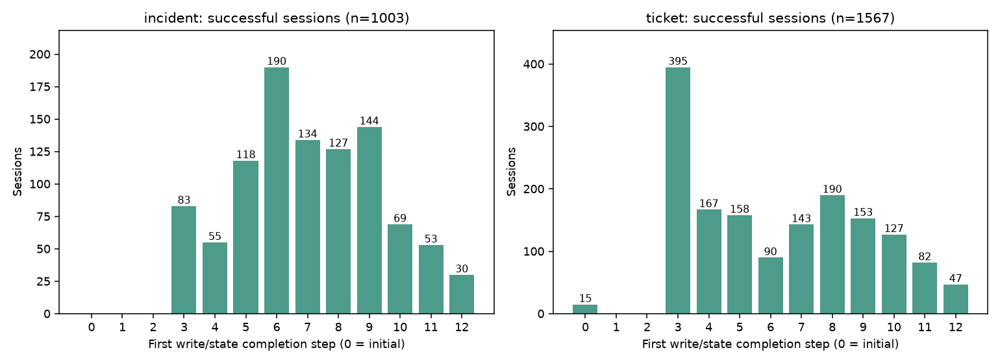
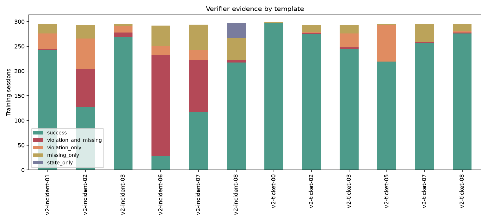
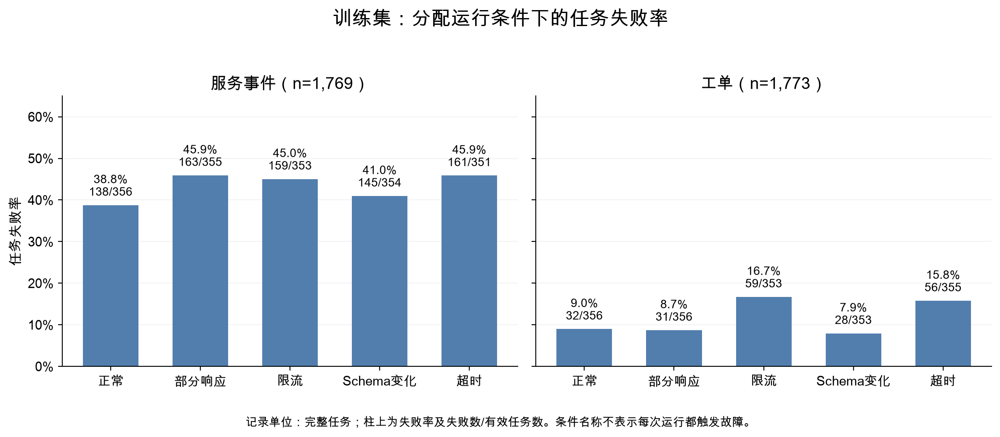
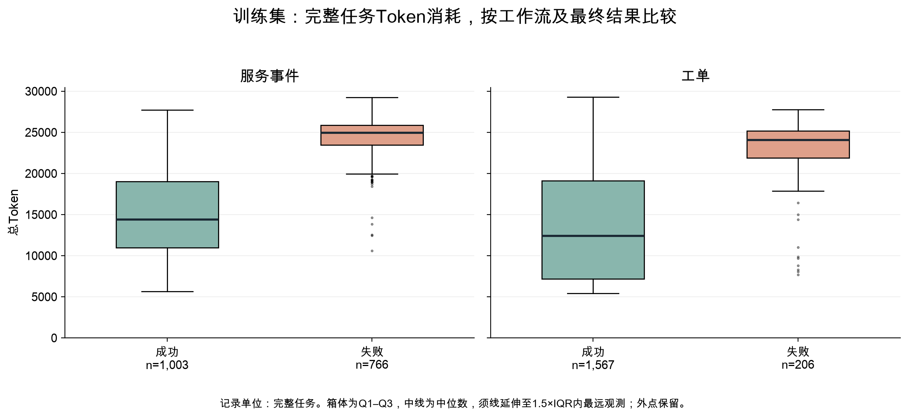
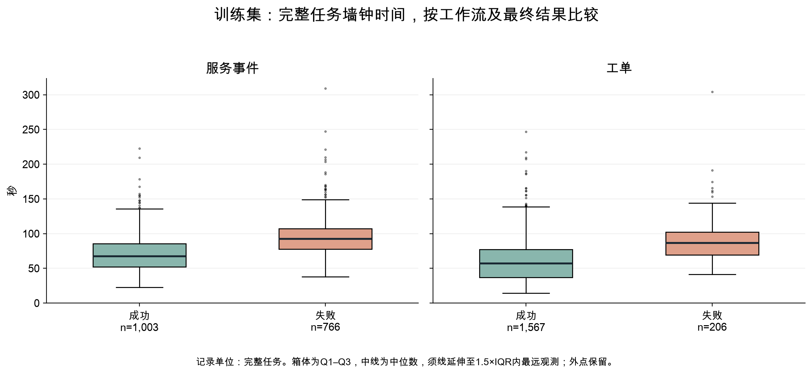
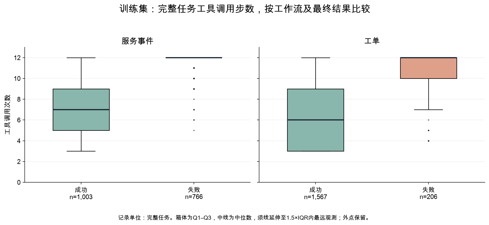
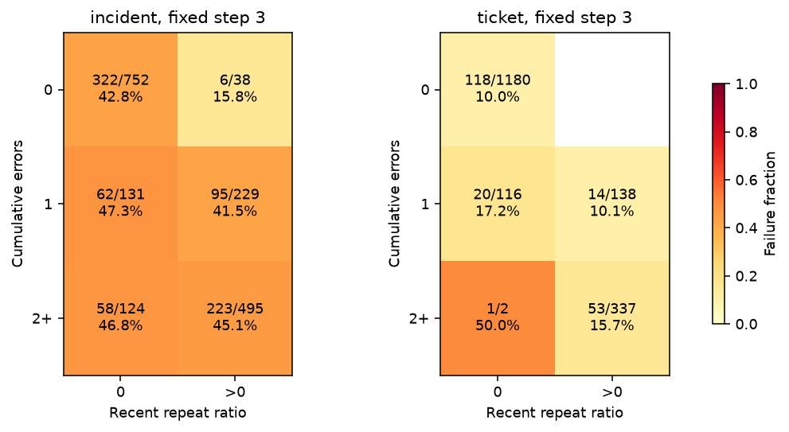
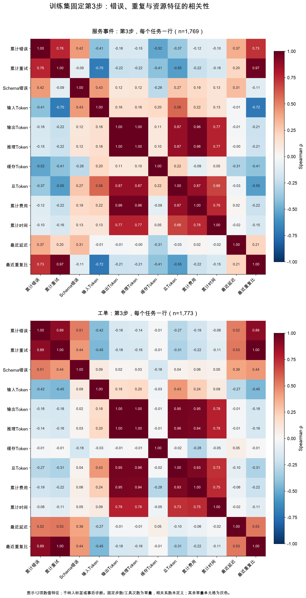
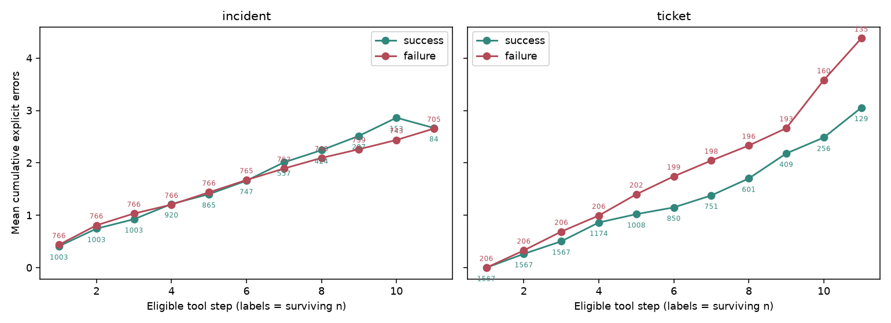

# 第二轮训练集 EDA：结果与建模依据

完成日期：2026-11-06。基于封印数据集 `artifacts/expanded_dataset_v1`，
分析 3542 条有效训练 Session、27367 条可决策前缀，以及 58 条无效训练尝试的质量分布。
只用训练分区解释失败、检查特征与选取例子。验证、测试仅经过已有加载器的完整性检查。
本文记录EDA阶段；后续主实验已完成，完整研究结论见[最终报告](RESEARCH_REPORT_6000_FINAL.md)。

基础诊断产物见 [expanded_eda_v2/report.md](../artifacts/expanded_eda_v2/report.md)。
当前保留v2，初次分析的重复产物已在仓库整理中清除；v2补充了观察训练结果后发现的写入顺序问题，
将无需写入任务的完成时点修正为初始状态，并细分非预期写入类型。
这些是探索性诊断，不能包装为预注册的验证结论。原始数据、标签与分区未改写。

## 提案EDA覆盖与报告补充

原v2只有4张图，没有完整覆盖提案第4节的5类可视化要求：缺少故障失败率柱状图、
Token／耗时／步骤箱线图，以及Spearman相关热图；描述统计和异常值回查的展示也不充分。
报告定稿时已补充5张图，合计9张，并将统计结果与解释直接写入最终报告第3节。
这次补充仅分析同一训练分区，发生在模型实验之后，不作为事前发现，也未触发模型或阈值调整。

| 提案要求 | 现有交付与报告位置 |
| --- | --- |
| 缺失、重复、异常数值／时间、极端轨迹回查 | 第3.1节；[逐字段质量表](../artifacts/expanded_eda_supplement_v1/missing_and_numeric_quality.csv)、[外点统计](../artifacts/expanded_eda_supplement_v1/tukey_outliers.csv)、[代表性极端轨迹检查](../artifacts/expanded_eda_supplement_v1/extreme_trajectory_checks.json) |
| 按结果、工作流和条件统计数量、失败率、均值、标准差、中位数与四分位数 | 第3.3、3.7节；[分组数量](../artifacts/expanded_eda_supplement_v1/grouped_counts.csv)、[完整描述统计](../artifacts/expanded_eda_supplement_v1/grouped_descriptive.csv)，含工作流×条件×结果组合 |
| 故障失败率柱状图，标失败数／总数 | 图1；[分工作流柱状图](./figures/research_report_6000/05_condition_failure.png) |
| Token、耗时、步骤箱线图，按工作流分面 | 图4—6；[Token](./figures/research_report_6000/06_token_boxplot.png)、[耗时](./figures/research_report_6000/07_time_boxplot.png)、[步骤](./figures/research_report_6000/08_steps_boxplot.png) |
| 固定步骤错误×重复失败率热图，每格标n | 图7；保留原第3步热图，说明仅2个任务的小样本格 |
| 前缀趋势及仍可继续的任务数 | 图9；保留原逐步错误曲线与存活人数 |
| 固定步骤Spearman相关热图 | 图8；[分工作流相关热图](./figures/research_report_6000/09_step3_spearman.png)，常量不记为零相关 |
| 检验不完整响应与显式报错的恢复差异 | 第3.5节；[恢复对照](../artifacts/expanded_eda_supplement_v1/recovery_comparison.csv)，区分事件恢复率和任务成功率 |

补充得到的主要结果：

- 有效任务资源字段及22项前缀输入均无缺失，数值列没有非有限值或负值，任务／步骤键没有重复。
  真实发生的4,702次相邻同参重试保留。全部训练尝试有58条完整输入／输出Token与费用缺失、
  4条推理Token缺失，均不补零。
- 分组箱线图有62条耗时上侧外点；回查每个工作流×结果组的Token与时间最大值，共6条任务、
  24个原始文件，用量、时间顺序和哈希均一致。最长任务308.99秒，最多Token为30,661；
  所有外点保留。服务事件失败组的步数Q1与Q3均为12，下侧外点不能理解为日志错误。
- 显式读取错误恢复4,031/5,926次（68.02%），其中政策错误恢复1,267/1,838次（68.93%）；
  不完整政策响应补全590/804次（73.38%）。已恢复事件的间隔中位数分别为1、1、2步。
  不支持直接声称不完整响应更难恢复；恢复定义、任务构成和剩余观察机会不同，不能作因果比较。
- 第3步按工作流计算，重试与最近重复比的Spearman相关为0.974／1.000，
  总Token与费用为0.869／0.932。分组后依然高度相关，不能把单个模型系数解释为独立影响。

补充分析保留独立目录，未覆盖原v2产物及其封印。新增图同时保存PNG与SVG。

## 主要发现

### 1. 训练失败以步数耗尽为主，没有输出截断

训练成功 2570 次、失败 972 次，失败率 27.44%。其中 757 次失败耗尽工具步数，
215 次正常结束但验证失败，输出截断为 0。

| 最终验证证据（互斥） | 次数 | 含义 |
| --- | ---: | --- |
| 违规写入且缺必要写入 | 411 | 做了不该做的，同时尚未做完必要操作 |
| 仅违规写入 | 253 | 必要操作均出现，但存在额外或错误操作 |
| 仅缺必要写入 | 277 | 没有已应用的违规操作，必要操作未做完 |
| 仅最终状态不匹配 | 31 | 写入内容齐全，但事件/通知列表顺序错误 |

最后 31 次全部来自 `v2-incident-08`，公开指令要求按 service_id 顺序处理依赖服务。
逐条验证显示，只排序最终 incidents/notifications 列表后状态即一致。
因此这是有明确任务依据的失败，不应通过忽略列表顺序改成成功。

### 2. 主要问题是额外写入和未完成任务；重复完整读取很少

757 次预算失败中，651 次缺必要写入（86.00%），477 次有违规写入（63.01%），
519 次出现显式工具错误（68.56%），216 次至少有一个同参数读错误未等到后续 ok（28.53%）。
这些证据重叠，比例不能相加。

严格定义的“同工具、同参数、完整响应相同、期间无已应用写入”的重复读取，
仅出现在 20 次预算失败中；达到两次重复完整读取的仅 1 次。
这不支持把本轮大部分预算失败笼统归因为“不断重复成功读取”。
不同对象的探索、错误重试和不完整响应重试不包含在这个计数内。

全部 664 次含违规操作的失败中，没有精确重复必要写入的情况，均包含非预期操作。
其中，incident 工作流有 539 条 Session 使用了任务没有要求的写工具，
534 条包含非预期 `update_ticket`。ticket 工作流有 103 条更新了未要求的字段，
95 条使用了未要求的写工具；这些 Session 集合仍可能重叠。
单纯工具返回 ok 并不能识别这些业务错误。

80 条失败轨迹曾满足写入与状态验证，随后继续做额外写入而失败。
这提示“任务已完成后继续执行”的行为值得单独研究，但私有完成证据不能输入预测器。

### 3. 报错次数不能直接替代失败标签

2570 次成功中有 1316 次出现显式错误（51.21%），548 次累计至少 3 次错误。
363 次成功仍存在某次同参数读错误没有后续 ok；这只表示该调用没有按指定口径恢复，
不意味着验证器必然判定任务失败。

验证器只检查必要写入、额外/重复写入与最终状态，并不单独验证必要读取是否执行。
例如 schema_error 的工具结果可携带 raw_response，而“同参调用重新返回 ok”
是更严格且不同的恢复定义。不能把成功标签解释为所有读取都已规范恢复。

### 4. 过早停止会损失确实需要更多步骤的成功任务

835 条预算终止轨迹中有 78 条成功；77 条成功直到第 12 步才首次满足写入/状态验证，
占全部成功的 3.00%。其中 incident 30 条、ticket 47 条。

第 11 步可决策的成功轨迹共有 213 条：136 条当时已满足验证，77 条尚未完成。
因此应同时报告“告警了原本成功的 Session”与“停止导致尚未完成的任务无法完成”，
不能把二者混为一个数字。主误停预算仍保留按所有原成功 Session 计算的严格口径。

另有 15 条 `v2-ticket-08` 任务无需任何写入，初始状态就满足验证，完成时点记为 0。
此处“完成”始终指写入与状态判定，不代表所有读取指令已经执行。



### 5. 模板差异远大于统一规则能解释的程度

| 训练模板 | 失败/有效 | 失败率 |
| --- | ---: | ---: |
| v2-ticket-00 | 2/299 | 0.67% |
| v2-incident-06 | 264/292 | 90.41% |
| v2-incident-07 | 176/294 | 59.86% |
| v2-incident-02 | 165/293 | 56.31% |

`incident-01`、`incident-02` 两个父家族贡献 658/972 次失败（67.70%）。
完整训练集仍只有 6 个父家族，不是数千个独立任务结构。
分组 CV 和按家族报告结果是必要条件。

各模板平均已知费用从每次约 ¥0.06445（ticket-00）到 ¥0.22791（incident-07），
相差约 3.54 倍。incident 成功/失败 Token 中位数为 14407/24945.5，
ticket 为 12410/24061.5；这些完整资源差异不能当作早期预测能力。





每根柱标注失败率及失败数／有效任务数。服务事件的部分响应组失败率为45.9%，正常组为38.8%；
工单对应比例为8.7%与9.0%，说明故障条件需要结合任务结构解释。







以上三图均以完整任务为单位，按工作流和最终结果分组，横轴标注样本数。
箱体为Q1至Q3，中线为中位数，须线延伸至1.5倍四分位距范围内的最远观测，外点全部保留。
服务事件失败组的工具步数Q1、中位数和Q3均为12，因此箱体收缩为一条线。

### 6. 第 3 步的简单错误与重复信号有限

全部 3542 条有效训练 Session 在第 3 步都有可决策前缀；当时没有已应用的违规写入，
31 次顺序失败的首次顺序不匹配也都在第 3 步之后。

第 3 步 incident 成功/失败平均 Token 为 4277/4226，ticket 为 4246/4289。
同一步资源用量差异小于完整轨迹差异。按工作流、相同错误档位比较，
有重复调用的格子并不呈现稳定的更高失败率；ticket 的“2+错误、无重复”格只有 2 条。

重试数与最近重复比的 Spearman 相关为 0.981，说明信息高度重叠。
晚期 incident 成功轨迹的错误均值甚至高于失败轨迹，但第 11 步只剩 84 条成功，
不能把这种存活样本的变化解释为错误有利于成功。





两个分面分别对应1,769条服务事件和1,773条工单任务，每个任务仅贡献一条第3步前缀。
图示12项错误、重复与资源特征，不纳入最终标签或事后诊断；常量列的相关系数不记作零。



点旁数字为该步仍可决策的任务数。后期留下的成功任务通常更难完成，
不能把成功曲线后期错误较多解释为报错有利于成功。

### 7. 批次效应需要与风险信号分开

训练分区中，50 并发阶段无效 24/300（8.00%），10 并发阶段无效 34/3300（1.03%）。
有效 Session 的每请求墙钟毫秒中位数分别约 9013/7930。
两组共覆盖 60 个训练模板×条件层；按共同层标准化后，平均每请求墙钟毫秒约为 9284/8301。

并发与日期、恢复阶段、供应商状态混杂，上述结果不证明并发调整造成差异。
elapsed_ms/model_calls 包含生成、客户端与收尾开销，也不等于单独测得的模型延迟。
应在第二轮预先加入去掉时间类特征的敏感性分析。

全部训练尝试的已知费用合计 ¥602.001106，仍有 58 次请求费用未知；
有效训练 Session 费用完整。无效记录继续排除出业务建模，未知费用不计作零。

## 由EDA提出的建模要求（已完成）

以下要求已进入[冻结方案](EXPANDED_MODEL_PROTOCOL.md)，
并完成[模型比较与测试](EXPANDED_MODEL_RESULTS.md)，在此保留其建模依据：

- LR 为主模型，KNN、固定规则、步数规则、永不停止为对照；冻结候选网格和每 Session 抽样方式。
- 延续 22 列可观察特征基线与父家族 CV。资源/错误、工具类别/顺序/写入阶段、时间指标消融单独预定义。
- 只在验证分区选择 5%/10% Session 误停预算阈值；所有方案冻结后一次性测试。
- 分别衡量终止前告警、第 3 步等固定早期预测、首次违规前告警与成功任务完成损失。
- 原 `first_violation_step` 不覆盖顺序错误；冻结时需明确主口径和包含顺序错误的敏感性口径。
- `expected_write_count`、`required_writes_remaining`、`clean_completion_now`、
  `unexpected_subtype`、`order_only_failure` 等全部为后验诊断，禁止作为模型输入。
- 继续报告每个模板/父家族的结果；处理未知费用、无告警、空子集后再执行第二轮评价。

EDA本身没有训练模型、选择阈值或启动收费采集；后续实验结果单独记录。

## 复现与产物

使用 `.venv`，输出必须是新目录：

```bash
.venv/bin/python -m agentsentinel.expanded_eda \
  --dataset artifacts/expanded_dataset_v1 \
  --output artifacts/expanded_eda_v3 \
  --workers 6
```

上例 v3 用于复现，已有 v2 不覆盖；源数据迁移后加 `--source`。

报告补充使用独立脚本，输出同样必须是新目录：

```bash
.venv/bin/python scripts/supplement_training_eda.py \
  --output artifacts/expanded_eda_supplement_reproduce
```

脚本仅加载训练观测，验证所读数据表的原封印，并在执行前后核对输入与代表性原始文件哈希。
全量原始时间戳审计沿用已有审计证据，本次另行检查6条极端轨迹，不声称重做全量采集审计。
补充产物的[统计口径与检查摘要](../artifacts/expanded_eda_supplement_v1/summary.json)、
[独立产物清单与输入哈希](../artifacts/expanded_eda_supplement_v1/manifest.json)保留可追溯记录。
脚本不训练模型、不生成验证／测试预测，也不调用收费接口。

- [完整报告](../artifacts/expanded_eda_v2/report.md)：分类、比例、例子与图。
- [分析口径](../artifacts/expanded_eda_v2/analysis_plan.json)：运行前记录、探索修订说明、输入封印与代码哈希。
- [Session 诊断](../artifacts/expanded_eda_v2/diagnostic_sessions.csv)、
  [事件证据](../artifacts/expanded_eda_v2/diagnostic_events.csv)：重放结果与恢复时点。
- [写入细分](../artifacts/expanded_eda_v2/unexpected_write_types.csv)、
  [顺序失败](../artifacts/expanded_eda_v2/state_only_details.csv)：额外错误类别。
- [产物封印](../artifacts/expanded_eda_v2/manifest.json)：36 个产物哈希；
  所读 7084 个原始文件在分析前后均与全量审计哈希一致。

EDA阶段验证记录：初版新增 19 项测试后，全量回归 304 项通过；修订后 EDA 专项共 25 项全部通过，
新增覆盖零写入任务、顺序错误和写入子类型；Ruff 通过。v2 输入、产物和代码哈希再次核验通过。
