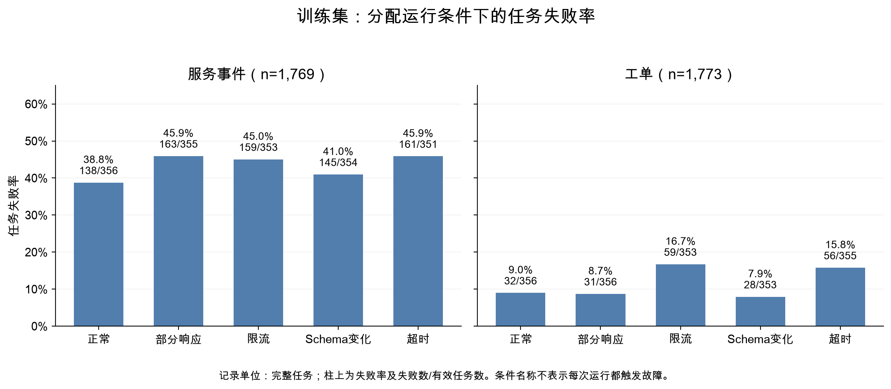
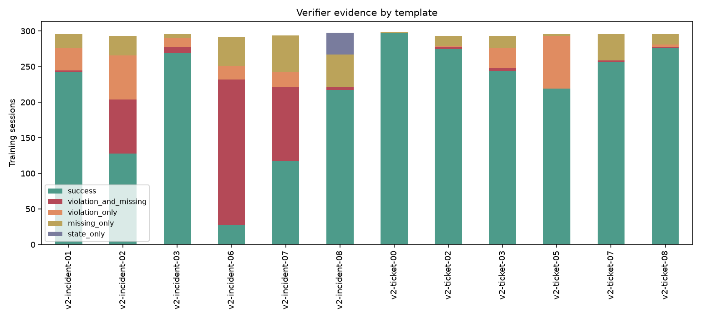
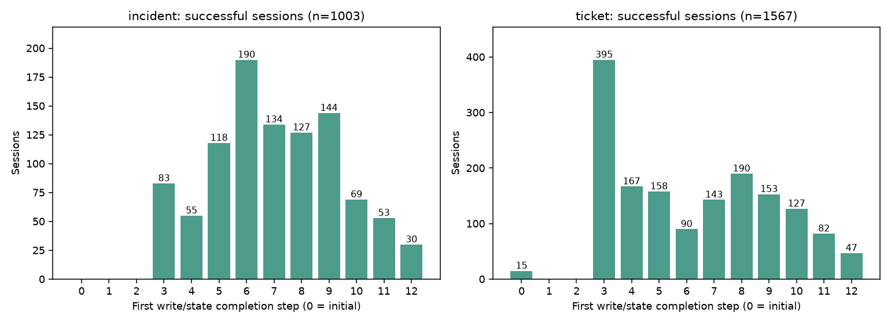
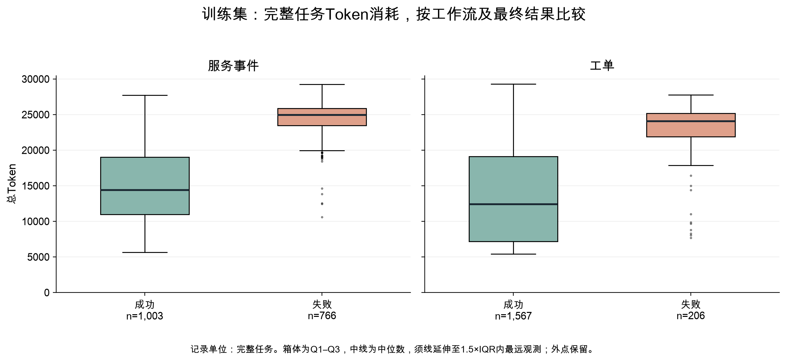
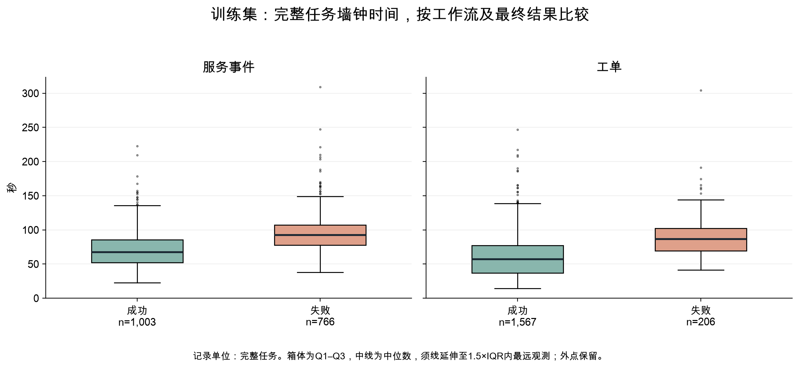
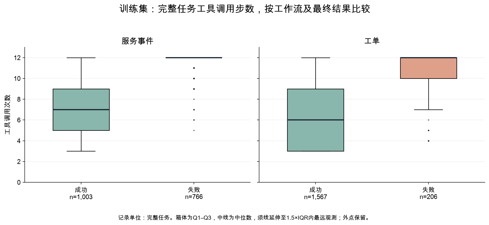
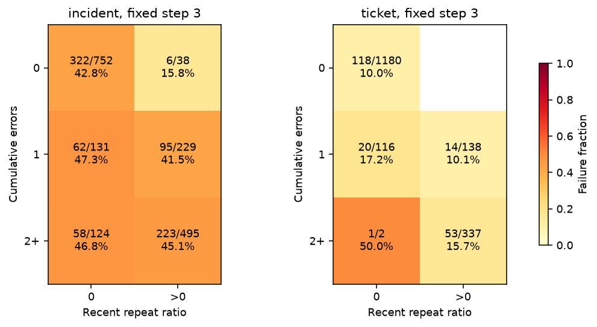
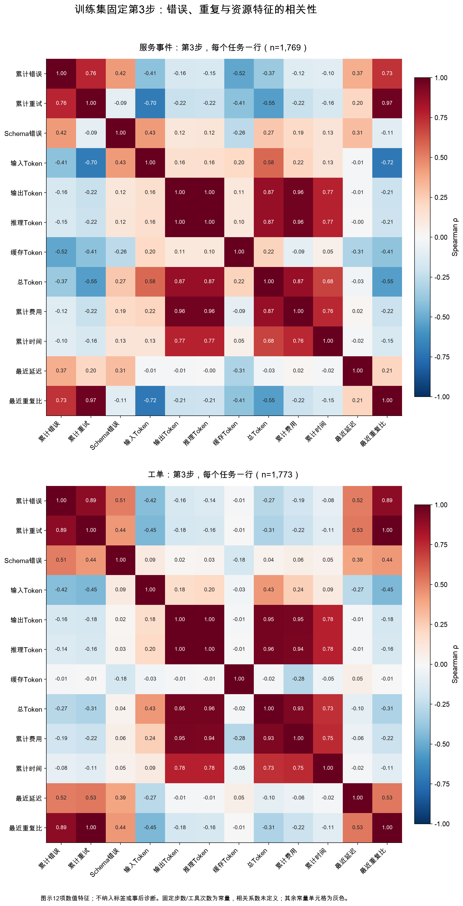
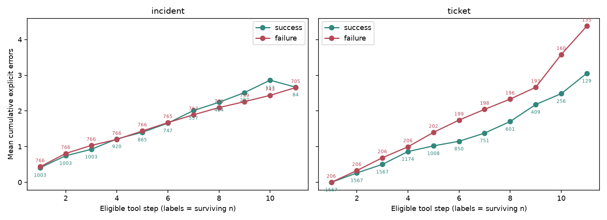

# AgentSentinel-Lite：基于运行时工具事件的智能体失败预测与提前停止研究

**最终研究报告｜2026年11月6日**

## 摘要

能够调用工具的大语言模型智能体，在执行任务时可能经历工具错误、重复读取、错误写入和预算耗尽。运行异常是否意味着任务最终失败，以及是否应据此提前停止，不能仅凭单次报错判断。本研究利用真实大语言模型在本地模拟服务台中执行工单和服务事件任务，采集6,000条完整运行轨迹，经审计保留5,894条有效任务及47,184条可决策前缀，研究结构化运行信号的预测能力及提前停止的收益与代价。

训练集探索性数据分析发现，972次失败中有757次耗尽工具步数，664次包含违规写入，两类证据存在重叠。与此同时，2,570次成功中有1,316次出现显式工具错误，77次直到第12步才首次完成任务；另有80次最终失败的任务曾经达标，随后又因额外写入而失败。完整失败轨迹通常消耗更多资源，但第3步的成功与失败任务在累计Token上相近，错误与重复也未形成跨工作流一致的单调失败关系。模板之间的失败率从0.67%到90.41%，表明任务结构差异显著，不能以统一错误阈值或总体平均代替分组分析。

在上述分析基础上，主实验以逻辑回归（Logistic Regression，LR）为主要模型，与K近邻（K-Nearest Neighbors，KNN）、固定规则和步数规则比较。采用按父任务家族冻结的训练、验证和测试分区，主LR使用22项可观察运行特征，在测试集取得全前缀ROC AUC 0.8413、第3步AUC 0.7422。按验证集5%误停预算选定的策略识别267/321次失败，离线估算节省9.74%的费用，但误停17次原本成功的任务；考虑3次停止时已达标的原失败任务后，严格状态回放成功数仍净减少14次。首次违规前告警仅覆盖32/268条含违规任务。

后续探索增加调用历史和公开响应字段完整性特征，将输入扩展至48项。在既有测试集的90%失败概率、连续两步确认规则下，相对探索阶段的22项特征对照，误停由4次降至3次，费用节省由5.39%升至5.83%，第6步结束前识别的失败由14次增至60次，但仍未实现无成功损失，部分预测指标也出现退化。

研究表明，结构化工具事件具有失败预测价值，能够帮助识别部分无效执行；然而，预测最终失败、预防首次违规和保护任务成功是不同目标。现有证据尚不足以支持无损自动停止或提高实际在线完成率。全部停止收益来自离线回放，结论限定于本研究的模型、任务环境和验收标准。

**关键词：** 大语言模型智能体；逻辑回归；探索性数据分析；失败预测；提前停止；任务可靠性

## 1. 引言

### 1.1 研究背景

大语言模型智能体（Agent）能够围绕用户目标，连续选择并调用工具。以服务台任务为例，智能体需要读取工单、查询服务状态、理解处理规则，再决定是否更新记录、追加备注或记录事件。一次任务通常包含多次模型请求和工具操作，其结果取决于完整执行过程。

这类系统的失败具有过程性。工具超时后，智能体可能通过重试取得信息并成功完成任务；工具返回正常时，智能体也可能修改错误对象、增加未要求的操作，或者在任务已经完成后继续写入。随着执行延长，失败任务还可能持续消耗Token、时间和调用费用。

因此，可靠性监测面临两项相互制约的目标：尽早识别可能失败的运行，减少后续无效开销；同时保留暂时受阻但仍能够完成的任务。过于激进的停止策略可能降低完成率，而过于保守的策略又可能只能在错误发生之后告警。

### 1.2 研究问题与定位

本研究围绕以下问题展开：

1. 成功与失败任务在错误、重复调用、写入行为和资源消耗上有何差异？这些差异是否在早期已经出现？
2. 工具异常、任务结构和运行预算分别对应哪些失败表现？哪些异常仍可恢复？
3. 仅使用已经发生的工具事件，逻辑回归能否有效预测最终失败，并优于KNN和简单规则？
4. 在限制成功任务误停的条件下，提前停止能够节省多少资源，又会损失多少成功任务？
5. 增加调用历史和公开响应完整性信息，能否改善早期识别和成功保护？

相关工作包括压力条件下的可靠性评价ReliabilityBench [1]、可重放的智能体干预分析AgentCheck [2]、完整轨迹失败诊断AgentRx [3]、前缀预警PrefixGuard [4]、在线审计AgentForesight [5]，以及提前失败预测与重启研究Fail-Fast, Restart-Smart [6]。这些工作提供了问题背景和方法参照。本研究没有在上述工作的数据集上复现，也不进行跨论文数值排名。

本文的研究重点是检验低维、可观察的运行指标能够提供多少失败信息，并将预测质量、告警时机、资源节省和成功损失放在同一评价框架中。研究没有重新训练执行任务的大语言模型，也不使用额外的大模型裁判提供标签。

## 2. 研究设计与数据

### 2.1 任务环境与运行单位

实验采用本地模拟服务台，包含工单处理和服务事件处理两类工作流。读取工具用于获取工单、服务状态和处理规则；写入工具用于更新工单、追加备注、记录事件和发送模拟通知。业务对象、工具接口与初始状态由程序构造，智能体的决策、模型请求和执行轨迹来自真实运行。

例如，一项服务事件任务可能要求智能体先查询指定服务，读取相应政策，在满足条件时记录事件并追加工单备注。该任务可以因遗漏必要记录而失败，也可以在完成记录后，又额外修改工单状态而失败。工具执行成功仅表示接口完成了操作，不代表操作符合任务要求。

一个Session表示一次完整任务运行。第 $t$ 次工具调用返回之后，从任务开始至该时刻的全部已观察事件称为一个执行前缀。模型可以在任务继续执行时反复更新风险预测，但同一任务的不同前缀并非独立任务。

本批次包含20个结构模板，每个模板20个参数实例，每个实例在5种条件下各重复3次：

$$
20\times20\times5\times3=6{,}000
$$

20个模板归属于10个父任务家族。父家族表示共享基础任务结构的一组模板，参数实例则主要改变具体对象和内容。同一父家族的子模板、实例、故障条件、重复运行及全部前缀始终保留在同一数据分区。

### 2.2 故障条件与模型配置

五种运行条件分别为正常、超时、限流、Schema变化和部分响应。Schema变化表示返回结构与工具约定不一致，部分响应表示返回了不完整信息。故障作用于服务状态和政策读取工具，协议中的故障概率为0.7、持续故障概率为0.3、瞬时故障调用数为2。

故障条件是运行设置，不直接决定任务标签；分配到某种条件，也不保证每次运行都会实际触发故障。超时和限流由本地工具模拟返回，不对应真实网络等待时长。

| 配置项 | 本批次设置 |
| --- | --- |
| 执行模型 | kimi-k3-1-pro-261024 |
| 模型接口 | 火山方舟OpenAI-compatible Chat Completions |
| 温度 | 1.0 |
| 每任务工具调用上限 | 12次 |
| 每任务模型请求上限 | 24次 |
| 累计Token与任务墙钟时间上限 | 均未设置 |
| 单次输出Token上限 | 不显式发送该参数，采用供应商默认设置 |
| 网络请求超时 | 60秒 |
| 自动API重试 | 0次 |
| 非缓存输入／缓存输入／输出单价 | 13／1.3／68元每百万Token |

未显式设置输出上限不表示输出无限长。本批次没有因输出截断而终止的任务，工具步数上限仍可能使任务在尚未完成时结束。全部采集均未启用研究中的风险停止策略，从而保留完整原始轨迹供离线评价。

### 2.3 数据质量、有效性与分区

全量审计核验了6,000个唯一计划项、24,000个任务原始文件及7个控制文件，检查任务配置、原始流式响应、工具操作、状态变化、最终标签、逐步用量与费用，并比较检查前后的文件哈希。审计未发现完整性不一致。

基础设施或协议异常单独标记为无效运行，保留其原始记录和已知支出，但排除出业务成功／失败建模。无效运行包括连接超时、读取超时、连接错误、HTTP错误和供应商多工具协议违规，不通过补跑替换。

| 分区 | 父家族数／模板数 | 采集次数 | 有效任务 | 成功 | 失败 | 无效 | 可决策前缀 |
| --- | ---: | ---: | ---: | ---: | ---: | ---: | ---: |
| 训练 | 6／12 | 3,600 | 3,542 | 2,570 | 972 | 58 | 27,367 |
| 验证 | 2／4 | 1,200 | 1,176 | 997 | 179 | 24 | 10,529 |
| 测试 | 2／4 | 1,200 | 1,176 | 855 | 321 | 24 | 9,288 |
| 合计 | 10／20 | 6,000 | 5,894 | 4,422 | 1,472 | 106 | 47,184 |

有效任务成功率为75.03%。1,472次有效失败中，1,031次耗尽工具步数，441次正常结束但未通过验收。全部有效任务中，共有1,216次以步数预算终止，其中185次仍通过最终验收。因此，“预算耗尽”与“失败”不能互相替代。

训练、验证和测试任务的失败比例不同，这是冻结家族分区的实际结果。研究保留这种差异，没有为平衡标签而重新分配模板。

### 2.4 成功标签与费用口径

最终结果由确定性验证器生成。成功要求必要写入按任务要求完成，最终状态匹配，且完整写入历史中不存在非预期或重复操作；否则为失败。历史违规写入即使后来被正确状态覆盖，也不自动恢复为严格成功。

验证器不独立检查所有必要读取是否执行，也不评价最终自然语言回复的质量。因此，本文中的成功、当前达标和停止后保留成果，均限定于必要写入、历史合规与最终状态。隐藏的验收答案及事后诊断字段只用于监督和评价，不进入运行时预测器。

6,000次任务共记录53,726次模型请求。审计从3次协议错误请求的完整流式响应中恢复用量，补计0.0795114元；对账后的已知费用为1,006.602469元，仍有103次请求费用未知。未知用量不记作零，恢复费用也不改变任务有效性。

上述金额覆盖全部采集的已知支出，包括无效运行，不等同于完整供应商账单。有效分析任务的所需费用完整；测试集基线费用为206.1985612元，Token总量为20,046,195。缓存Token属于输入Token子集，推理Token属于输出Token子集，均不重复计入总用量或费用。

## 3. 探索性数据分析

### 3.1 分析范围与统计原则

探索性数据分析（Exploratory Data Analysis，EDA）限定于训练分区的3,542条有效任务、27,367条可决策前缀；运行质量分析另包含58条无效训练尝试。验证和测试分区不用于本阶段的特征观察或案例选择。

任务失败率、完成时点和费用以完整任务为统计单位。前缀趋势仅纳入各步骤仍可继续的任务，固定分析时点为第3、6、9、11步，不对已结束任务补齐后续记录。任务验收重放得到的缺失操作、违规和当前完成状态用于解释失败，不作为可直接输入模型的特征。

本节回答三个层次的问题：失败最终表现为什么；这些表现与工作流、故障条件和资源消耗有何关系；能够在任务早期观察到的信号是否足以支持停止。统计结果属于描述性关联，失败证据不等同于互相独立的因果解释。

数据质量检查区分有效分析记录与全部训练尝试，结果如下：

| 检查对象 | 检查结果 | 处理与解释 |
| --- | --- | --- |
| 3,542条有效任务的资源与错误统计字段 | 缺失、非有限值、负值均为0 | 总Token、推理Token、费用与时间可直接统计 |
| 27,367条可决策前缀的22项输入特征 | 各列缺失率均为0；数值列无非有限值、负值 | 本批次无需因这些字段缺失删除前缀 |
| 任务ID、计划项ID、前缀与工具事件的“任务ID＋步骤”键 | 重复记录均为0；28,202条工具事件无完全重复行 | 保留真实发生的4,702次相邻同参重试，不能当作日志重复删除 |
| 全部3,600次训练尝试的完整输入、输出Token与费用 | 每列缺失58条，缺失率1.61% | 均属于无效尝试；完整费用未知不等于没有已知支出 |
| 全部训练尝试的推理Token | 缺失4条，缺失率0.11% | 保留缺失；已有部分推理用量也不代表完整请求用量可得 |
| 原始时间戳与事件顺序 | 既有全量审计未发现创建时间越出批次区间、负时间、时间倒退或请求／工具序列不一致 | 时间质量检查与任务墙钟长短分别解释 |

极端值采用分工作流、分最终结果的箱线图规则标记：低于 $Q_1-1.5\,IQR$ 或高于 $Q_3+1.5\,IQR$，其中 $IQR=Q_3-Q_1$。训练任务中有62条耗时超过所在组上界，Token有1条高于上界、30条低于下界。这些是分布上的外点，不自动视为损坏记录。

分别选取两类工作流、两种结果下Token最多和耗时最长的轨迹，去重后回查6条任务、24个原始文件。逐请求用量、工具序列、汇总时间及文件哈希均一致。最长任务耗时308.99秒，12次模型请求的累计耗时为308.98秒；Token最多的任务累计30,661个Token，其中6,883个为推理Token，耗时304.13秒。成功任务也有246.97秒的长轨迹，不能把长耗时直接标为失败。本批次未设累计Token和任务墙钟上限，因此上述记录并不违反采集配置；所有外点均保留。

后文同时报告均值、样本标准差、中位数和四分位数，标准差使用 $n-1$ 分母，四分位数采用线性插值。标准差描述任务间离散程度，不是均值置信区间。基础诊断在模型实验前完成；故障分面、资源箱线图、相关热图及更完整的描述统计和恢复对照在报告定稿时补充，均限定同一训练分区，没有据此修改已冻结的模型、阈值或测试结果。

### 3.2 失败主要表现为未完成必要操作和违规写入

训练集有972次失败，失败率为27.44%。其中757次因工具步数预算耗尽而终止，占失败的77.88%；其余215次正常结束但未通过验收，没有输出截断。

按最终验证证据，可将失败互斥划分为四类：

| 最终失败证据 | 任务数 | 占训练失败比例 | 含义 |
| --- | ---: | ---: | --- |
| 违规写入且缺必要写入 | 411 | 42.28% | 做了不应做的操作，同时没有完成全部必要操作 |
| 仅违规写入 | 253 | 26.03% | 必要写入已出现，但包含额外、错误或不允许的操作 |
| 仅缺必要写入 | 277 | 28.50% | 没有已记录违规，但任务要求的写入尚未完成 |
| 仅最终状态不匹配 | 31 | 3.19% | 必要操作齐全且无上述违规记录，但最终状态仍不符合要求 |
| 合计 | 972 | 100.00% | 各类互不重叠 |

前两类合计664次，说明违规写入是训练失败的重要组成。全部664次均包含非预期操作，没有精确重复必要写入的情况。服务事件工作流中，534条失败轨迹出现了任务未要求的工单更新。这类操作可以返回正常状态，却仍然违反任务目标。

31次仅状态不匹配均来自同一服务事件模板。任务要求按服务ID顺序处理多个服务，实际生成的事件和通知内容齐全，但列表顺序错误。只排序最终列表即可消除差异，表明失败来自有明确任务依据的顺序约束，而非缺少内容。研究保持原标签，没有通过忽略顺序提高成功率。

预算终止则是运行如何结束的描述。757次预算失败中的证据如下：

| 预算失败中的证据 | 任务数 | 占757次预算失败比例 |
| --- | ---: | ---: |
| 缺少必要写入 | 651 | 86.00% |
| 出现违规写入 | 477 | 63.01% |
| 出现显式工具错误 | 519 | 68.56% |
| 同参数读错误在结束前没有后续正常返回 | 216 | 28.53% |
| 出现不完整政策响应 | 128 | 16.91% |
| 出现严格定义的重复完整读取 | 20 | 2.64% |

同一任务可同时具有多项证据，比例不能相加。例如，任务可能先反复读取不完整信息，再错误更新对象，最终仍缺少必要记录而耗尽预算。将这些任务统一称为“循环失败”会掩盖不同的执行过程。

这里的重复完整读取要求工具和参数相同、完整响应与上次相同，且期间没有已应用写入。符合该严格定义的预算失败仅20次，达到两次重复完整读取的仅1次。大量读取步骤并不等于不断重复已经完成的同一读取，也可能涉及不同对象、错误恢复或获取缺失字段。

**建模启示：** 仅识别预算接近耗尽或累计错误增加不足以解释失败。预测器需要同时观察调用背景、执行阶段和恢复过程；评价时也应将终止原因与业务验收结果分开。

### 3.3 故障条件改变失败构成，但正常运行也会失败

| 运行条件 | 有效任务 | 失败任务 | 失败率 | 预算失败 | 完整轨迹Token中位数 |
| --- | ---: | ---: | ---: | ---: | ---: |
| 正常 | 712 | 170 | 23.88% | 88 | 14,590 |
| 部分响应 | 711 | 194 | 27.29% | 148 | 16,653 |
| 限流 | 706 | 218 | 30.88% | 200 | 20,194.5 |
| Schema变化 | 707 | 173 | 24.47% | 116 | 17,202 |
| 超时 | 706 | 217 | 30.74% | 205 | 20,141 |

**图1. 五种运行条件下的训练任务失败率。** 每个分面对应一种工作流，每根柱标出失败率与失败数／有效任务数。各条件与工作流组合有351—356条有效任务；这些重复运行仍共享有限的模板结构，不能视为同等数量的独立任务类型。

限流和超时条件下的失败率较高，Token中位数也较大。两类条件的失败中，预算失败分别占91.74%和94.47%，说明在本实验设置下，读取受阻与耗尽执行机会经常同时出现。

正常条件仍有170次失败，其中159次包含违规写入。这说明没有注入工具故障并不能保证模型按任务边界行动。另一方面，Schema变化条件的失败率接近正常条件，不能仅凭故障名称判断其破坏程度；模型仍可能从返回内容中取得信息或通过后续调用恢复。

分面揭示了总体比例掩盖的差异：服务事件的部分响应组失败率为45.9%，正常组为38.8%；工单对应比例为8.7%与9.0%。工单的限流和超时组则分别为16.7%和15.8%。因此，不能给故障类型排出一套适用于所有任务的固定危险等级；应同时观察工作流、任务要求与实际恢复过程。

这些统计按分配的运行条件汇总，不等同于实际故障触发率。有效性排除、任务结构和模型生成差异也会影响组间结果，本文不将条件均值直接解释为真实业务环境中的普遍因果效应。

**建模启示：** 故障类型适合事后分组评价，不应作为预测特征。运行时需要依赖智能体真正观察到的返回、错误和调用历史。

### 3.4 工作流与模板差异显著

训练集服务事件任务共1,769条，其中失败766次；工单任务共1,773条，其中失败206次。两类工作流数量相近，但失败组成差异很大。进一步按模板分组，可以观察到更强的异质性。

**图2. 训练模板的最终验收结果。** 每根柱表示一个模板的全部有效训练任务。绿色为成功，红色为违规且缺必要写入，橙色为仅违规，黄色为仅缺必要写入，紫色为仅状态不匹配。各模板样本量接近，但结果分布明显不同。

| 模板 | 有效任务 | 失败任务 | 失败率 | 每任务平均费用／元 |
| --- | ---: | ---: | ---: | ---: |
| v2-incident-01 | 296 | 53 | 17.91% | 0.16558 |
| v2-incident-02 | 293 | 165 | 56.31% | 0.20308 |
| v2-incident-03 | 296 | 27 | 9.12% | 0.16275 |
| v2-incident-06 | 292 | 264 | 90.41% | 0.22732 |
| v2-incident-07 | 294 | 176 | 59.86% | 0.22791 |
| v2-incident-08 | 298 | 81 | 27.18% | 0.16133 |
| v2-ticket-00 | 299 | 2 | 0.67% | 0.06445 |
| v2-ticket-02 | 293 | 18 | 6.14% | 0.16087 |
| v2-ticket-03 | 293 | 49 | 16.72% | 0.18645 |
| v2-ticket-05 | 296 | 77 | 26.01% | 0.15128 |
| v2-ticket-07 | 296 | 40 | 13.51% | 0.17192 |
| v2-ticket-08 | 296 | 20 | 6.76% | 0.13937 |

最容易与最困难模板的失败率分别为0.67%和90.41%。两个服务事件父家族合计贡献658/972次训练失败，占67.70%。即使同属工单工作流，模板失败率也从0.67%变化到26.01%，不能仅靠工作流名称概括任务难度。

平均费用最低与最高模板分别约为0.06445元和0.22791元，相差3.54倍。任务费用同时受读取路径、输出量、写入要求和执行长度影响，统一平均单价会掩盖这种差别。较高失败率与较高费用在部分模板上共同出现，但该关联不能证明费用本身导致失败。

**建模启示：** 随机拆分相关前缀容易让模型在训练和测试中重复看到相近任务结构。因此，分区和交叉验证必须保留父家族边界，结果也需要按家族报告。数千条重复运行不能替代更多独立任务结构。

### 3.5 报错之后仍有大量成功，停止必须保护恢复过程

2,570次训练成功中，1,316次出现过显式工具错误，占51.21%；548次累计错误至少3次，占21.32%。因此，“出现错误就停止”或“错误达到三次就停止”都会覆盖大量原本能够成功的任务。

显式错误恢复采用可观察定义：某次读取报错后，稍后相同工具和参数返回正常状态。然而，正常返回仍可能缺少政策字段，故另外记录响应完整性。两种恢复定义不能混为一谈。

针对“部分响应是否比显式报错更难恢复”，将正常返回但缺少`action`或`owner`的政策调用单独统计；其恢复要求后续相同调用同时返回两个字段。结果如下：

| 异常类型 | 恢复事件／异常事件 | 事件恢复率 | 已恢复事件的间隔中位数／步 | 涉及任务数 | 其中最终成功／比例 |
| --- | ---: | ---: | ---: | ---: | ---: |
| 全部显式读取错误 | 4,031／5,926 | 68.02% | 1 | 1,919 | 1,316／68.58% |
| 其中：显式政策读取错误 | 1,267／1,838 | 68.93% | 1 | 1,053 | 683／64.86% |
| 不完整政策响应 | 590／804 | 73.38% | 2 | 385 | 228／59.22% |

限定同一种政策工具后，不完整响应的补全比例仍没有低于显式报错的后续正常返回比例。按工作流看，服务事件的两种比例分别为73.78%和69.19%，工单分别为72.37%和68.44%。在已经恢复的事件中，不完整政策响应整体需要的间隔中位数较长，为2步；其中服务事件为2步，工单为1步。

因此，这批数据不支持简单声称“不完整响应更难恢复”。它提示了另一种区别：字段后来得到补全，不保证整项任务最终成功；不完整响应所涉及任务的总体成功比例较低，但两类人群的模板构成、异常发生位置和后续写入不同，不能归因为响应形式本身。

表中恢复率以事件为分母，任务成功比例以去重后的任务为分母；同一任务可能贡献多次异常，也可能出现在多行。显式政策错误是全部读取错误的子集。没有观察到恢复也可能是任务已结束或预算耗尽，较晚发生的异常得到后续观察的机会更少。两种恢复标准不同，以上仅为描述性对照，不能据此认定哪种故障更容易处理。

训练成功中还有363次存在某次同参数读错误没有后续正常返回。该现象不意味着标签错误：模型可能通过其他信息路径推进，某些错误返回也可能携带可用内容，且验证器不单独验收全部必要读取。它说明“所有读错误都按同一形式恢复”比本研究的任务成功标准更严格。

一个成功实例经历了服务状态Schema错误，随后又连续两次遇到政策Schema错误，仍在第8步更新工单、第9步追加备注并通过验收。错误统计在执行过程中可能升高，但最终成功标签始终为成功。

**建模启示：** 风险概率应随新证据更新，而不应在首次错误后永久判为失败。仅提高失败召回不够，还需检查被告警任务原本是否能够通过后续读取恢复。

### 3.6 成功的完成时点不同，达标后继续执行也可能失败

训练集中835条任务以工具步数预算终止，其中78条最终成功。2,570次成功中，有77次直到第12步才首次满足完整验收，占3.00%；其中服务事件任务30次，工单任务47次。

**图3. 成功任务的首次达标时点。** 左侧为1,003条成功服务事件任务，右侧为1,567条成功工单任务。第0步表示初始状态已满足当前验收；第12步表示直到最后允许的一次工具调用才首次达标。两类工作流均存在较晚完成的成功任务。

在第11步仍可继续的213条成功任务中，136条已经达标，77条尚未完成，即36.15%仍需要最后一步。这说明即使执行接近预算上限，也不能把继续运行一律视为浪费。

另有15条成功工单任务不需要任何写入，初始状态就满足写入与状态验收，完成时点记为0。这个结果反映验收边界，并不证明读取指令已经执行。

与晚完成相反，80条最终失败的训练轨迹曾经满足严格验收，随后因额外写入而失败。例如，一条轨迹在第8、9步完成必要工单更新，第10步又进行未要求的更新，第11、12步继续追加不必要的备注和事件，最终失败。

这两类过程需要不同的决策：对尚未完成但仍可成功的任务，应保留执行机会；对已经达标后又可能破坏成果的任务，及时结束可能有益。但真实达标状态依赖隐藏验收答案，只能用于离线评价，不能直接交给风险模型。

**建模启示：** “最终会失败”“当前已完成”与“现在停止会造成成功损失”是不同问题。停止评价必须同时统计误停、尚未完成的成功损失，以及原失败在停止时已经达标的情况。

### 3.7 完整轨迹的资源差异明显，早期差异却很弱

完整任务的资源分布如下。Q1、Q3分别为第25与第75百分位数，表中“±”后的数值为样本标准差。

| 工作流与结果 | 任务数 | 指标 | 均值±标准差 | Q1 | 中位数 | Q3 |
| --- | ---: | --- | ---: | ---: | ---: | ---: |
| 服务事件成功 | 1,003 | 总Token | 14,849.79±5,357.12 | 10,954.50 | 14,407 | 19,013.50 |
| 服务事件失败 | 766 | 总Token | 24,603.96±2,042.07 | 23,447 | 24,945.50 | 25,875.25 |
| 工单成功 | 1,567 | 总Token | 13,586.59±6,681.45 | 7,188 | 12,410 | 19,112.50 |
| 工单失败 | 206 | 总Token | 23,078.70±3,630.61 | 21,882 | 24,061.50 | 25,164.25 |
| 服务事件成功 | 1,003 | 耗时／秒 | 70.79±25.88 | 52.29 | 67.37 | 85.73 |
| 服务事件失败 | 766 | 耗时／秒 | 94.86±27.10 | 77.65 | 92.61 | 107.43 |
| 工单成功 | 1,567 | 耗时／秒 | 59.61±28.56 | 36.69 | 56.90 | 77.44 |
| 工单失败 | 206 | 耗时／秒 | 89.94±30.26 | 69.32 | 86.52 | 102.16 |
| 服务事件成功 | 1,003 | 工具步数 | 7.07±2.33 | 5 | 7 | 9 |
| 服务事件失败 | 766 | 工具步数 | 11.71±0.81 | 12 | 12 | 12 |
| 工单成功 | 1,567 | 工具步数 | 6.33±2.80 | 3 | 6 | 9 |
| 工单失败 | 206 | 工具步数 | 10.77±1.77 | 10 | 12 | 12 |

**图4. 完整任务的总Token分布。** 箱体表示Q1至Q3，中线为中位数，须线延伸至1.5倍四分位距范围内的最远观测，外点保留。失败组主要集中在较高用量区间，成功组分布较宽，说明高用量也可能对应较复杂但最终成功的任务。

**图5. 完整任务的墙钟时间分布。** 箱线定义同图4。成功和失败组均存在长尾，四组分别有15、20、20、7条高于组内箱线图上界的任务。墙钟时间包括模型生成、客户端和收尾开销；本地模拟超时不会直接产生对应时长的网络等待。

**图6. 完整任务的工具调用步数分布。** 服务事件失败组的Q1、中位数和Q3均为12，箱体收缩为一条线；该组120条少于12步的失败任务因四分位距为0而显示为下侧外点。这是硬预算附近聚集的分布特征，并非数据错误。

失败任务的完整Token中位数分别约为同工作流成功任务的1.73倍和1.94倍，工具步数中位数均达到12。完整轨迹的失败确实伴随较多资源消耗，说明减少失败任务后续执行具有潜在价值。

成功／失败任务的推理Token中位数在服务事件中为1,149／1,316.5，在工单中为873／1,183.5。推理Token属于输出Token的一部分，不能再与总Token相加。

按运行条件汇总资源分布如下。各条件样本量与第3.3节一致，均包含该条件下的成功和失败任务。

| 条件 | 指标 | 均值±标准差 | Q1 | 中位数 | Q3 |
| --- | --- | ---: | ---: | ---: | ---: |
| 正常 | 总Token | 14,764.70±7,061.73 | 6,719 | 14,590 | 19,889.25 |
| 部分响应 | 总Token | 16,456.99±7,555.87 | 9,768 | 16,653 | 24,442 |
| 限流 | 总Token | 18,059.57±6,514.86 | 12,055.50 | 20,194.50 | 23,757 |
| Schema变化 | 总Token | 17,059.39±7,171.82 | 10,153 | 17,202 | 24,310 |
| 超时 | 总Token | 18,074.98±6,710.82 | 11,654 | 20,141 | 24,000.50 |
| 正常 | 耗时／秒 | 66.36±28.85 | 44.05 | 65.38 | 84.63 |
| 部分响应 | 耗时／秒 | 75.02±37.56 | 48.84 | 70.09 | 95.40 |
| 限流 | 耗时／秒 | 72.14±28.60 | 50.63 | 71.50 | 90.08 |
| Schema变化 | 耗时／秒 | 74.64±30.38 | 52.38 | 71.37 | 94.55 |
| 超时 | 耗时／秒 | 72.68±27.96 | 52.35 | 72.52 | 92.66 |
| 正常 | 工具步数 | 6.85±3.07 | 3 | 7 | 9 |
| 部分响应 | 工具步数 | 7.64±3.32 | 5 | 8 | 11 |
| 限流 | 工具步数 | 8.82±3.05 | 6 | 9 | 12 |
| Schema变化 | 工具步数 | 7.73±2.99 | 5 | 8 | 10 |
| 超时 | 工具步数 | 8.78±3.11 | 6 | 9 | 12 |

限流与超时的工具步数中位数均为9，高于正常条件的7；但耗时均值最高的是部分响应组，约75.02秒。Token、步骤和墙钟时间的条件排序并不完全一致，不能用其中一个指标代替全部资源开销。

但这种事后差异不能直接证明早期可识别。固定在第3步观察，结果如下：

| 工作流 | 最终结果 | 任务数 | 累计错误均值 | 最近重复比例均值 | 累计Token均值 |
| --- | --- | ---: | ---: | ---: | ---: |
| 服务事件 | 成功 | 1,003 | 0.925 | 0.205 | 4,277 |
| 服务事件 | 失败 | 766 | 1.034 | 0.219 | 4,226 |
| 工单 | 成功 | 1,567 | 0.504 | 0.087 | 4,246 |
| 工单 | 失败 | 206 | 0.689 | 0.108 | 4,289 |

第3步覆盖全部训练任务，此时尚未出现已应用的违规写入。服务事件失败任务的Token均值甚至略低于成功任务；工单两组也很接近。错误均值虽在失败组较高，但组间均值差异不能作为可靠的单任务停止判据。

**建模启示：** 资源特征可能帮助识别较后期的执行状态，但不能把完整失败轨迹更长、更贵，解释为模型在第3步已经知道这些未来消耗。评价必须固定早期时点，避免只报告全前缀分数。

### 3.8 早期错误与重复没有稳定的统一阈值

进一步将第3步的累计错误分为0、1、2次及以上，将最近重复比例分为0与大于0，得到失败率热图。

**图7. 第3步错误与重复的联合分布。** 每格标注失败数／任务数及失败率。左侧为服务事件，右侧为工单；空白格表示没有样本。比例必须结合样本量解释，不能将空白视为零失败率。

服务事件任务中，没有错误且没有重复的组失败322/752次，失败率42.8%；没有错误但有重复的组失败6/38次，失败率15.8%。在已有1次错误时，无重复组失败率47.3%，有重复组为41.5%。这些组并未表现为重复越多、失败率越高。

工单任务也没有稳定的统一规律。已有1次错误时，无重复组失败率为17.2%，有重复组为10.1%；“至少2次错误且无重复”的组虽然失败率50%，却只有2个任务，不能据此建立高风险规则。

上述结果不证明重复有保护作用。不同组可能包含不同模板、信息依赖和恢复行为，简单分箱无法控制全部任务差异。其实际含义是：同一个错误或重复阈值不能在这些工作流中稳定代表相同风险。

第3步的Spearman相关分析还显示，重试数与最近重复比例的相关系数为0.981，总Token与费用为0.884，总Token与推理Token为0.894。部分指标承载高度相近的信息。固定步数等常量列的相关系数未定义，不作为零相关处理。

**图8. 固定第3步的特征相关性。** 上、下分面分别包含1,769条服务事件和1,773条工单任务，每个任务仅贡献一行。图示12项错误、重复和资源特征，各对变量均无缺失；色阶固定为−1至1。不纳入最终标签、故障条件或事后验收字段，固定步骤数和工具次数因无变化不绘制。

按工作流分别计算后，重试数与最近重复比例的相关系数仍分别为0.974和1.000；总Token与费用分别为0.869和0.932。输出Token与推理Token的相关系数分别为0.999和0.998，图中四舍五入后接近1不表示数值完全相同。相关性在固定执行长度后仍然较高，说明重复信息不仅来自长任务累积更多Token，也与用量构成及特征定义有关；固定步骤分析本身无法估计与任务长度的相关性。

**建模启示：** 特征应在联合模型中解释，并通过消融检查信息来源。相关特征的单个系数不宜视为独立作用，更不能解释成因果效应。

### 3.9 跨步骤趋势必须同时观察存活样本

**图9. 成功和失败任务的逐步累计错误均值。** 点旁数字为该步骤仍可决策的任务数。服务事件成功任务由早期1,003条减少到第11步84条，失败任务在第11步仍有705条；两组后期曲线对应的人群已明显不同。

在服务事件工作流中，成功任务的后期错误均值可达到或超过失败任务。不能据此判断报错有利于成功，因为较容易的成功任务已经结束，后期留下的是读取较久、错误较多但仍能恢复的任务。

工单工作流的错误均值分离相对明显，但同样存在存活人数变化。不同步骤的总体指标既受到新增信息影响，也受到已完成任务退出样本的影响。

**建模启示：** 应在每个时点报告有效任务数，并补充同时具有多个时点前缀的共同任务队列。否则，后期较高的分类性能可能被误认为对所有任务都实现了同等改进。

### 3.10 批次差异与EDA对后续方法的约束

运行质量分析包含全部3,600次训练尝试。50并发阶段的300次尝试中有24次无效，无效率8.00%；10并发阶段的3,300次尝试中有34次无效，无效率1.03%。有效任务的每请求墙钟时间中位数分别约为9,013毫秒和7,930毫秒。

在60个共同的模板与条件分层内标准化后，平均每请求墙钟时间仍分别约为9,284毫秒和8,301毫秒。但并发与采集日期、暂停恢复阶段及供应商状态同时变化，即使分层也不能将差异全部归因于并发。任务墙钟时间还包含客户端与收尾开销，不等同于单独测得的模型延迟。

训练全部尝试的已知费用为602.001106元，仍有58次请求费用未知。有效训练任务的所需费用完整；无效尝试继续排除出业务失败模型，其未知费用不补零。

EDA为建模提供了以下具体依据：

| EDA发现 | 后续方法中的处理 |
| --- | --- |
| 报错后仍有大量成功，错误和重复缺少统一阈值 | 同时比较联合特征模型与简单规则，明确报告成功任务误停 |
| 失败轨迹更长、更贵，但早期资源均值接近 | 固定第3步为主要早期时点，并进行Token与费用特征消融 |
| 存在第12步才完成及达标后破坏的任务 | 分开统计告警、成功损失和停止时达标，保留完整验收口径 |
| 任务结构与费用高度异质 | 按父家族划分数据和交叉验证，报告各家族的结果与成本 |
| 工具阶段信息可能携带较强信号 | 预定义工具身份、前序工具、写入次数及仅阶段特征消融 |
| 时间受批次和运行条件混杂 | 增加去除时间特征的敏感性分析，限制时延结果的解释 |
| 事后诊断能够解释失败但包含隐藏答案 | 严格隔离诊断字段与运行时输入 |

因此，EDA的结果不是一条可直接部署的停止规则，而是明确了失败组成、误停风险和评价中的混杂因素，为后续冻结模型与评价方案提供依据。

## 4. 预测模型与评价方法

### 4.1 最终结果预测与逻辑回归

设任务 $i$ 的最终标签为 $Y_i$，失败取1，成功取0。第 $t$ 次工具返回后的可观察特征为 $x_{i,t}$，逻辑回归估计：

$$
p_{i,t}=P(Y_i=1\mid x_{i,t})
=\frac{1}{1+\exp[-(\beta_0+\beta^\top z_{i,t})]},
$$

其中 $z_{i,t}$ 为经过插补、编码和标准化后的特征。逻辑回归虽然名称包含“回归”，本研究将其用于成功与失败的二分类概率预测。

同一任务的全部前缀共享相同最终标签。任务前期报错、后期恢复并成功时，所有前缀的真实失败标签仍为0。执行过程中变化的是模型依据已有信息给出的概率，而不是任务的最终监督标签。

模型预测的是既定智能体策略与运行预算下的自然结局，不表示任务在任何其他行动方式下都无法恢复。每步重新预测也不等于在线重新训练模型参数。

主实验采用22项特征：

| 信息组 | 特征 |
| --- | --- |
| 进度与写入 | 当前步数、累计工具调用数、累计写入数 |
| 错误与重试 | 累计错误数、重试数、Schema错误数、连续错误数 |
| 资源 | 输入、输出、推理、缓存及总Token，累计费用 |
| 时间 | 累计运行时间、最近调用延迟 |
| 最近窗口 | 最近错误数、同工具调用数、重复比例 |
| 调用背景 | 当前工具、前一工具、工作流、当前状态 |

任务或模板ID、故障条件、注入器标记、最终验证结果、真实当前完成状态、首次违规步和未来资源均不进入模型。工具事件发生之后且仍有继续执行机会的位置才作为可决策前缀，第12步不产生新的停止决定。

### 4.2 训练、交叉验证与对照

每个训练任务按步骤最多等距抽取6条前缀，共得到19,094条拟合行。主实验按抽样行拟合，限制长轨迹的贡献，但不保证每个任务的拟合总权重相同。

训练采用三折父家族交叉验证，每折留出两个父家族。数值特征使用中位数插补、缺失标记和标准化，类别特征采用众数插补与独热编码。所有预处理均只在当前拟合折学习。

留出折使用全部可决策前缀评分，每条前缀权重为所在任务前缀数的倒数，使每个任务的评分总权重为1。按三折任务等权平均精确率（Average Precision，AP）的均值选择参数。

| 方法 | 候选设置 | 最终选择 | 训练交叉验证等权AP |
| --- | --- | --- | ---: |
| 逻辑回归 | 正则化参数C为0.1、1、10；无类别权重或平衡类别权重 | C=1，无类别权重 | 0.6969 |
| KNN | 邻居数3、5、9；均匀或距离加权 | 9个邻居，距离加权 | 0.5892 |
| 固定OR规则 | 步数、重试数、连续错误数、总Token的训练分位数阈值 | 验证集选择，并允许关闭触发项 | — |
| 步数规则 | 训练步数候选 | 验证集选择，并允许永不停止 | — |
| 永不停止 | 不干预原轨迹 | 固定参考 | — |

主实验预先指定完整22项特征LR为主模型，另外设置7种LR消融变体。全部模型、规则和停止策略冻结之后，才执行首次独立测试。

### 4.3 阈值选择与离线停止

停止阈值仅在验证集选择，主要成功任务误停预算为5%，次要预算为10%。原成功任务只要触发首次告警就计为误停，即使告警时已经达标，也不放宽预算定义。

在满足预算的候选中，选择全体验证任务执行费用最低的策略；必要费用缺失时，整个选择过程统一切换为Token目标。完整LR的主失败概率阈值为0.7380596938，首次达到阈值即停止。这里的5%是验证集误停比例约束，与约73.81%的失败概率阈值不同，也不构成对未来任务的误停保证。

主策略在验证集误停49/997次成功，识别131/179次失败。严格状态回放的成功数净减少48，因此在首次测试前已记录暂缓在线干预。包括8个LR变体、KNN、两类规则的两个预算及永不停止，共23项策略统一冻结后进行测试。

离线回放按原始前缀顺序寻找首次告警点。告警时的模型请求、工具操作和费用已经发生，只能扣除之后的资源。回放不重新生成停止后的行动，不假设智能体会自动修复任务。

### 4.4 评价指标与解释

AP与ROC AUC评价风险排序能力，Brier分数评价概率预测误差，Brier越低越好。全前缀普通指标对前缀等权，任务等权指标另行报告，避免长轨迹主导全部结论。第3步为主要早期评价点，第1、6、9、11步为补充时点。

| 停止指标 | 定义 |
| --- | --- |
| 成功任务误停率 | 被停止的原成功任务数／全部原成功任务数 |
| 失败告警召回率 | 被停止的原失败任务数／全部原失败任务数 |
| 停止判断精确率 | 被停止的原失败任务数／全部停止任务数 |
| 首次违规前告警率 | 告警步严格早于首次违规步的任务数／全部含违规任务数 |
| 费用节省率 | 全部任务基线费用与停止后费用之差／全部任务基线费用 |
| 严格成功损失 | 原成功任务中，停止时尚未通过原验收的数量 |
| 状态挽救 | 原失败任务中，停止时已经通过原验收的数量 |

严格状态回放的成功数按下式计算：

$$
N_{\text{停止后成功}}
=N_{\text{原成功}}-N_{\text{成功损失}}+N_{\text{状态挽救}}
$$

状态挽救只表示停止可以在原轨迹的某个时点保留已达标状态，不代表实施了修复。损失和挽救分别披露，挽救数不能抵扣误停预算。同一步写入后才告警，不计作违规前预防。

## 5. 预先冻结的主实验结果

### 5.1 预测质量及早期能力

测试集共有1,176条有效任务和9,288条可决策前缀。失败前缀比例为34.08%，普通全前缀评价如下：

| 模型 | 普通AP | 任务等权AP | 普通ROC AUC | 普通Brier |
| --- | ---: | ---: | ---: | ---: |
| 完整LR | 0.8030 | 0.7538 | 0.8413 | 0.1395 |
| 完整KNN | 0.7295 | 0.6774 | 0.7749 | 0.1702 |

LR在上述指标上优于KNN，说明联合的结构化运行信号具有预测价值。但全前缀分数包含较晚执行阶段，不能代替早期结果。

| 工具步骤 | 仍可决策任务数 | LR AP | LR AUC | LR Brier | KNN AUC |
| --- | ---: | ---: | ---: | ---: | ---: |
| 1 | 1,176 | 0.4841 | 0.7584 | 0.1612 | 0.7079 |
| 3 | 1,176 | 0.5175 | 0.7422 | 0.1878 | 0.6099 |
| 6 | 982 | 0.8624 | 0.8977 | 0.1051 | 0.8684 |
| 9 | 525 | 0.9796 | 0.9729 | 0.0647 | 0.9452 |
| 11 | 234 | 0.9851 | 0.9636 | 0.0737 | 0.9793 |

第3步已有一定区分能力，但明显弱于中后期，AUC也低于第1步。新增信息并不保证每一步的预测性能单调提高。第9步的较高AP同时伴随样本量下降至525条，与EDA中观察到的存活样本变化一致。

### 5.2 费用节省与成功损失

测试基线为855次成功、321次失败。下表预算均表示验证集约束：

| 策略 | 验证误停预算 | 成功误停数／率 | 失败告警数／召回率 | 费用节省率 | 严格成功损失／状态挽救 | 成功净变化 |
| --- | ---: | ---: | ---: | ---: | ---: | ---: |
| 完整LR，主策略 | 5% | 17／1.99% | 267／83.18% | 9.74% | 17／3 | −14 |
| 完整LR | 10% | 26／3.04% | 274／85.36% | 11.01% | 22／6 | −16 |
| 完整KNN | 5% | 0／0.00% | 0／0.00% | 0.00% | 0／0 | 0 |
| 完整KNN | 10% | 17／1.99% | 270／84.11% | 8.80% | 17／0 | −17 |
| 固定OR规则 | 5%／10% | 0／0.00% | 0／0.00% | 0.00% | 0／0 | 0 |
| 步数规则 | 5%／10% | 0／0.00% | 0／0.00% | 0.00% | 0／0 | 0 |
| 永不停止 | — | 0／0.00% | 0／0.00% | 0.00% | 0／0 | 0 |

5%预算下KNN选择永不停止，固定规则与步数规则在两个预算下均关闭触发项。因此它们在本次选择方案中未产生停止收益，这不等于证明所有规则设计都无效。10%预算下的KNN有较高失败召回，但同时损失17次原成功任务。

主LR共停止284次，其中267次来自最终失败任务，17次来自原成功任务。全部17次误停都发生在尚未通过验收时；另有3次原失败在告警时已达标。停止后的回放成功数为：

$$
855-17+3=841
$$

因此，误停比例虽然低于验证预算，严格成功数仍然下降。

主策略节省费用20.087795元，其中18.0449418元来自原失败任务，2.0428532元来自误停成功任务；节省Token共2,998,646，占基线14.96%，其中失败任务贡献2,813,158，误停成功任务贡献185,488。推理Token节省62,377，属于输出子集，不另行累加。

这些结果说明策略可以减少后续执行资源，但总节省包含牺牲成功任务产生的部分，不能全部称为无损收益。

### 5.3 终止前识别与违规前预防

主策略在被告警的失败任务中，平均比原终止提前3.82个工具步骤、约10,536个Token和26.41秒。但在268条含违规任务中，仅32条在首次违规之前告警，违规前覆盖率为11.94%。

267次失败告警中，32次早于首次违规，55次与首次违规同一步，154次晚于违规，另26次没有原记录中的写入违规。较高的失败召回主要说明能够识别将要以失败结束的运行，不能解释为同等比例的错误预防。

工具返回后评分的机制具有天然时间边界：当步错误写入已经发生，停止只能阻止之后的操作。在严格历史合规验收下，一些已经违规的任务无法通过后续改写恢复为成功，模型可能是在识别已形成的失败迹象。

主策略累计任务墙钟时间估算节省7,857.27秒，已计入约13.18秒评分开销。单次LR评分中位数约1.59毫秒，包含数据构造、预处理和预测，不含原始日志特征提取及调度。任务墙钟之和不等于并发批次完工时间，人民币估算也未计入独立的监测部署费用。

### 5.4 消融分析

以下变体均在首次测试前预定义，并采用5%验证误停预算：

| LR输入变体 | 成功误停 | 失败告警 | 首次违规前告警 | 费用节省率 | 成功净变化 |
| --- | ---: | ---: | ---: | ---: | ---: |
| 完整22项特征 | 17 | 267 | 32 | 9.74% | −14 |
| 去掉Token与费用 | 12 | 265 | 19 | 8.53% | −9 |
| 去掉错误类 | 20 | 254 | 44 | 9.39% | −11 |
| 去掉当前及前一工具 | 3 | 177 | 4 | 3.96% | −2 |
| 仅去掉前一工具 | 48 | 271 | 61 | 10.98% | −15 |
| 仅去掉累计写入数 | 0 | 255 | 4 | 5.37% | +2 |
| 去掉时间类 | 18 | 268 | 34 | 9.84% | −13 |
| 仅保留阶段类 | 7 | 241 | 11 | 6.96% | −5 |

删除工具身份后，训练交叉验证等权AP由0.6969降至0.6335；仅使用阶段类特征时仍为0.6738。这表明工具和执行阶段包含较强信号，错误数与资源消耗并非全部预测能力的来源。

去掉时间类的测试结果接近主模型，说明收益不完全依赖显式时间信息。只删除累计写入数的变体在本次测试没有误停，回放净增加2次成功，但首次违规前告警仅4次。该结果保留为预定义的次要发现，不能根据测试表现将其事后替换为主模型或直接部署。

消融只删除指定列，并非删除全部相关信息。例如工具名称仍可表达写入阶段，重复统计仍包含调用顺序。加之特征间存在相关性，不能将单次消融差异解释为独立因果效应。

### 5.5 家族差异与不确定性

| 测试父家族 | 有效任务 | 原成功／失败 | 成功误停 | 失败告警 | 首次违规前告警 | 基线费用／元 | 节省费用／元 |
| --- | ---: | ---: | ---: | ---: | ---: | ---: | ---: |
| incident-00 | 588 | 314／274 | 17 | 251 | 31 | 121.0524 | 19.5696 |
| ticket-01 | 588 | 541／47 | 0 | 16 | 1 | 85.1461 | 0.5182 |

主策略全部误停和绝大部分费用节省集中于服务事件家族。工单家族成功率更高，但失败覆盖和节省较低。该结果延续了EDA中的任务异质性，不能从总体收益推断每种任务都同样适合停止。

按完整父家族进行500次bootstrap重采样，描述性2.5%—97.5%区间为：误停率0.00%—5.41%，失败召回34.04%—91.61%，费用节省率0.61%—16.17%。测试只有两个父家族，区间主要反映家族组成变化，不能作为广泛任务泛化的置信保证。

测试集中没有仅顺序错误或初始无需写入的任务，排除这两类样本的敏感性结果与主结果相同。将顺序错误纳入首次违规时点的敏感性定义后，含违规任务数仍为268，违规前告警仍为32。

## 6. 后续探索：调用历史与响应完整性

### 6.1 目标、模型与证据范围

EDA和主实验共同显示，单纯错误统计难以区分可恢复读取与最终失败。后续探索因此加入同参数调用次数、工具序列、连续读取、跨步骤恢复以及公开响应字段完整性，将输入由22项扩展到48项。例如，政策读取返回正常状态但缺少公开契约中的必要字段时，新特征能够记录这种信息不足。

新增特征只使用当前及过去事件。原始对象标识和正文不直接作为模型列，参数用于相等性和计数，响应用于公开字段完整性判断。故障元数据、隐藏答案和未来信息仍被排除。

为避免混淆，三类模型的关系如下：

| 实验角色 | 输入特征 | LR正则化参数C | 模型选择依据 |
| --- | ---: | ---: | --- |
| 预先冻结主实验的完整LR | 22项 | 1 | 训练父家族交叉验证等权AP |
| 探索阶段22项特征对照 | 22项 | 10 | 训练交叉验证Brier |
| 探索阶段48项特征LR | 48项 | 0.1 | 训练折外预测的第3、6步平均Brier |

后续模型按任务等权拟合，模型与停止政策先在训练折外预测上选择，再冻结并生成验证预测。当前验收概率、剩余费用和剩余Token分别由一个辅助LR与两个Ridge模型预测，两种比较模型共享这些辅助头，其输出不作为主LR的新输入。

早期开发曾探索放宽状态完成定义，但该定义不同于原始严格验收，其完成收益不纳入本文效果证据。本文报告的最终任务预测及停止评价均采用原验收标准。

后续开发已经使用过主实验和验证集信息，测试复评也沿用首次主实验的同一测试集。即使复评前再次冻结模型、且不重新拟合，它仍属于探索性评价，不能称为新的独立盲测。

### 6.2 开发验证结果

在1,176条验证任务中，48项特征模型的第6步AUC由22项对照的0.80856升至0.86201，但第3步Brier由0.12525恶化至0.15199，第3步AUC由0.70528降至0.70080。

按0.5失败概率做单步分类，第3步识别的失败由24/179增加至76/179，同时将成功任务误判为失败的数量由15/997增至221/997。提高失败召回伴随明显的成功任务误判，不能据此认定早期预测全面改善。

在90%失败概率、连续两步确认的规则下，新模型在验证集停止79次，识别78次原失败，误停1次成功，费用节省1.97%；对照停止42次，均为原失败，节省0.93%。即使新增特征捕获了更多失败，仍然出现了可恢复成功任务损失。

### 6.3 既有测试集的同门槛比较

复评固定主规则为失败概率至少90%、连续两步确认、预计剩余费用至少0；补充规则为99%和80%，另设只预测参考。两模型共享辅助头，预计费用不可用时不停止。费用门槛为0，尚未证明剩余费用预测头对停止效果具有增量贡献。

| 模型 | 失败概率门槛 | 平均停止步 | 停止任务 | 失败告警／覆盖率 | 成功误停／率 | 费用节省率 |
| --- | ---: | ---: | ---: | ---: | ---: | ---: |
| 22项对照 | 90% | 8.13 | 241 | 237／73.83% | 4／0.47% | 5.39% |
| 48项LR | 90% | 7.75 | 240 | 237／73.83% | 3／0.35% | 5.83% |
| 22项对照 | 99% | 9.40 | 161 | 161／50.16% | 0／0.00% | 2.16% |
| 48项LR | 99% | 9.37 | 121 | 121／37.69% | 0／0.00% | 1.80% |
| 22项对照 | 80% | 7.76 | 251 | 245／76.32% | 6／0.70% | 6.32% |
| 48项LR | 80% | 7.56 | 266 | 259／80.69% | 7／0.82% | 7.05% |

平均停止步以发生停止的任务为分母，失败覆盖率以321次原失败为分母，成功误停率以855次原成功为分母。只预测模式不停止，节省为0，保留原855次成功。

90%主门槛下，新模型少误停1次，费用节省由11.112120元增至12.025348元，多节省约0.91元，即基线总费用的0.44个百分点。新模型节省中11.784641元来自原失败，0.240707元来自误停成功任务。

第6步结束前识别的失败由14次增至60次，但第3步结束前仍均为0。新模型首次违规前停止仅5/268次，对照为4/268次。严格状态回放成功数分别为852和851，仍低于原855次。

99%门槛下两模型均无误停，但新模型少识别40次失败；80%门槛下新模型多识别14次失败，同时多误停1次成功。因此改进体现为特定规则下的取舍变化，而非所有门槛的全面优越。

### 6.4 预测指标退化与误停案例

本节全前缀评价按任务等权，与主实验普通前缀指标的权重不同，不作直接跨表增减比较。

| 评价队列 | 任务数 | 对照Brier | 新模型Brier | 对照AUC | 新模型AUC |
| --- | ---: | ---: | ---: | ---: | ---: |
| 全前缀，任务等权 | 1,176 | 0.12324 | 0.12095 | 0.83404 | 0.82522 |
| 固定第3步 | 1,176 | 0.19017 | 0.17249 | 0.73412 | 0.75328 |
| 固定第6步 | 982 | 0.10420 | 0.10384 | 0.89972 | 0.90070 |
| 固定第9步 | 525 | 0.06376 | 0.05459 | 0.97472 | 0.98160 |
| 共同第3、6、9步队列，第3步 | 525 | 0.34490 | 0.30563 | 0.72155 | 0.70465 |
| 共同第3、6、9步队列，第6步 | 525 | 0.15156 | 0.15269 | 0.86421 | 0.85636 |

固定第3、6步平均Brier由0.147185降至0.138162，但全前缀AUC下降，10箱期望校准误差由0.02636增至0.04452，共同队列第3、6步AUC也下降。开发验证与测试复评的部分改善方向不同，说明效果受任务家族和人群组成影响。

按预先固定的排序规则选择首个主策略误停实例，原任务属于服务事件工作流。工具均返回正常状态，累计显式错误为0，但政策信息多次不完整。两模型均在第8步停止，原轨迹则直到第12步通过严格验收，全程没有历史违规。

| 步骤 | 操作 | 新模型预测最终成功概率 | 当步达标 | 原轨迹表现 |
| --- | --- | ---: | --- | --- |
| 6 | 读取政策 | 27.58% | 否 | 已出现5次不完整读取 |
| 7 | 读取工单 | 9.01% | 否 | 首次达到90%失败门槛 |
| 8 | 读取政策 | 2.34% | 否 | 连续第二步达到门槛，触发停止 |
| 10 | 读取政策 | 2.27% | 否 | 原轨迹随后取得完整政策 |
| 11 | 记录事件 | 41.30% | 否 | 完成一个必要写入 |
| 12 | 追加备注 | 不产生新决定 | 是 | 原任务最终成功 |

第10—12步属于未干预的原始轨迹，展示了停止会失去的恢复过程。新增完整性特征能够发现旧错误统计看不到的信息不足，但仍难以可靠区分“暂时没有读全”和“最终无法完成”。

## 7. 讨论与研究局限

### 7.1 EDA揭示了三种需要区别处理的状态

本研究观察到的执行过程至少包括：暂时出错但仍能恢复；已经违反严格任务约束；已经达标但仍继续执行。这三种状态可能都伴随重复调用、较多Token或较长步骤，却具有不同的干预含义。

最终失败预测把一条轨迹映射为一个结局概率，不能单独决定最优行动。对可恢复任务立即停止会损失成功；对已经违规的任务停止主要减少后续成本；对已经达标的任务结束执行则可能保留成果。将这三者区分开，是理解预测与停止效果差异的关键。

### 7.2 预测能力不能替代干预价值

较高AUC或失败召回说明当前事件包含最终结果信息，但不能证明信息出现得足够早，也不能证明停止提高完成率。主策略识别83.18%的失败，违规前覆盖却只有11.94%，并净损失14次成功。

严格历史合规意味着部分错误一旦发生，该任务就无法通过原验收。后续告警仍可能有节省价值，但更接近失败迹象识别，而非预防首次违规。运行时默认只返回预测，符合现有证据所支持的能力边界。

### 7.3 成功保护与费用节省存在取舍

降低门槛通常增加覆盖，也可能中断晚完成任务。高门槛在本次样本中无误停，并不保证未来仍为零误停，同时会减少失败覆盖与节省。主实验9.74%的费用节省与后续5.83%的节省对应不同拟合和策略选择方案，不能只比较数字大小来判断后者是否退步。

本文通过分开统计失败任务节省、误停成功任务节省和严格成功变化，保留了这种取舍。离线节省也未包含业务损失、用户补救成本和全部监测开销，不能直接作为部署收益。

### 7.4 任务多样性与评价独立性有限

数据来自一个执行模型、两类模拟工作流和预定义故障。训练只有6个父家族，测试只有2个父家族；模板失败率和费用差异较大，主策略收益高度集中于服务事件家族。大量参数实例与重复运行不能替代更多独立任务结构。

主实验的方法和策略先于首次测试冻结，后续探索则已经知道既有结果，并复用了测试集。后续再次冻结模型可以约束该轮操作，但不能恢复一个从未看过的独立测试集。因此，本文将后续结果作为探索性证据，不据此宣称普遍泛化改善。

### 7.5 标签与运行环境限制

确定性验收提供了可复核标签，但其范围不包含读取充分性、最终回复质量或真实用户满意度。本地模拟工具也没有覆盖真实业务中的权限、陈旧数据和复杂副作用。错误恢复、初始达标和任务成功的解释均受这一范围约束。

并发阶段与日期、恢复过程和供应商状态混杂，工具模拟超时不包含真实网络等待。费用来自冻结单价与记录用量，部分请求费用未知；累计任务墙钟节省不等于实际批次完工时间改善。全部停止效果均为原轨迹回放，本批次没有独立在线干预实测。

### 7.6 未来研究方向

后续研究可在新的独立任务家族上，预先定义成功保护要求和停止目标，再比较风险提示、延迟决策、完成检测及其他干预方式。必要读取与最终回复的验收范围也需要扩展，使成功标签更接近实际任务质量。

这些扩展需要新的评价设计，尤其要保留错误后恢复和最后一步成功的困难案例。不能通过反复调整本次测试集上的门槛，替代对新任务的检验。

## 8. 结论

本研究基于6,000次真实模型任务运行构建了可复核数据集，保留5,894条有效任务和47,184条可决策前缀。训练集EDA表明，失败主要涉及必要操作未完成和违规写入，工具报错并不等于任务失败，执行较长也不等于没有恢复价值。成功任务的晚完成、达标后继续破坏、任务家族异质性及后期存活样本变化，共同限制了统一早停规则的可靠性。

预先冻结的逻辑回归主实验显示，结构化工具事件能够提供最终失败预测信息。在本次测试中，LR概率预测优于KNN，并在验证误停预算约束下取得83.18%的失败召回与9.74%的离线费用节省；但严格状态回放成功数净减少14次，首次违规前告警仅覆盖11.94%的含违规任务。

后续48项特征模型在90%连续两步门槛下改善了中期告警，相对探索对照少误停1次、增加约0.91元节省，仍净损失3次成功，且未稳定改善全部预测指标。研究假设得到部分支持：运行信号具有风险提示和减少部分后续无效执行的价值，但可靠预防首次违规、无损自动停止和实际在线完成率提升尚未得到证明。

## 参考文献

[1] Gupta, A. ReliabilityBench: Evaluating LLM Agent Reliability Under Production-Like Stress Conditions. arXiv:2601.06112v1, 2026.

[2] Mazumder, A., & Lia, N. J. AgentCheck: A Reproduce-Intervene-Mitigate Workbench for LLM Agents over MCP. arXiv:2607.11098v3, 2026.

[3] Barke, S., et al. AgentRx: Diagnosing AI Agent Failures from Execution Trajectories. arXiv:2602.02475v2, 2026.

[4] Huang, X., et al. PrefixGuard: Online Failure Warning and Trace-Grounded Diagnosis for LLM Agents. arXiv:2605.06455v2, 2026.

[5] Zhang, B., et al. AgentForesight: Online Auditing for Early Failure Prediction in Multi-Agent Systems. arXiv:2605.08715v2, 2026.

[6] Wang, C., et al. Fail-Fast, Restart-Smart: Early Failure Prediction and Restart for SWE Agentic Tasks. arXiv:2608.03222v1, 2026.
