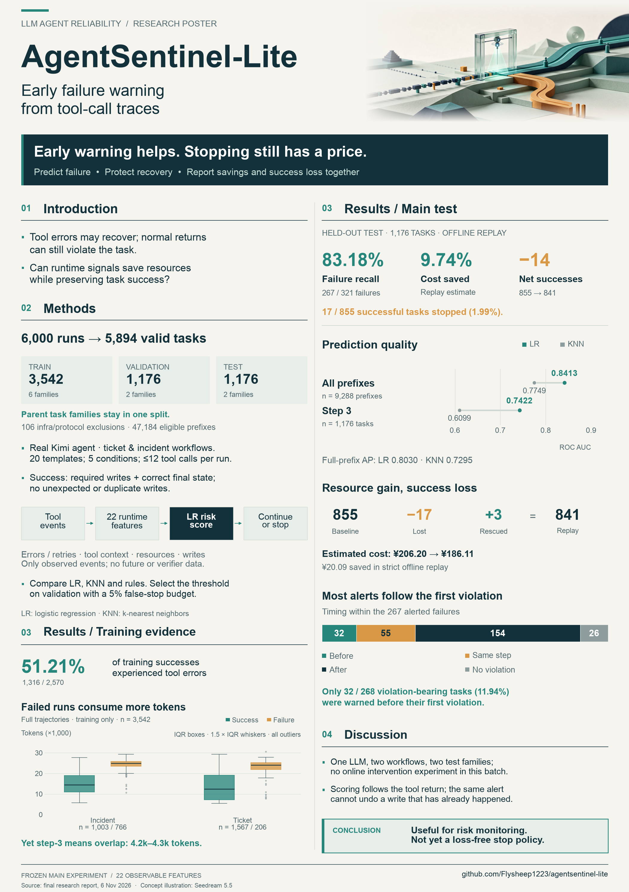
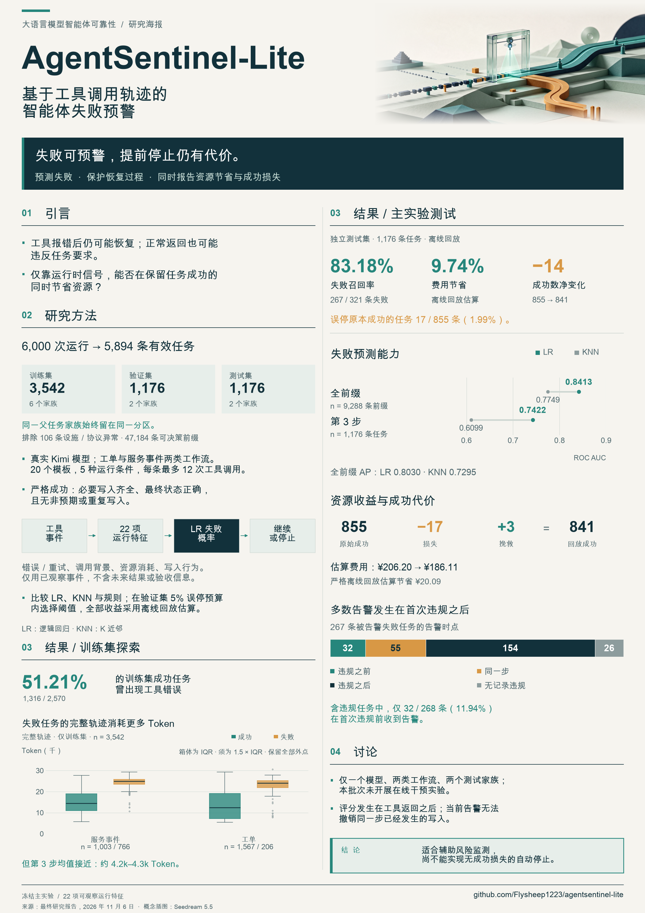

# AgentSentinel-Lite 学术海报

A1 竖版，594 × 841 mm。提供英文展示版与中文对照版。
采用双栏阅读顺序、IMRD 结构、要点文字、统一配色、真实数据图与带框结论。

| 用途 | 英文版 | 中文版 |
| --- | --- | --- |
| 打印 PDF（嵌入字体） | [EN.pdf](./AgentSentinel_A1_EN.pdf) | [ZH.pdf](./AgentSentinel_A1_ZH.pdf) |
| 300 dpi 高清图片 | [EN.png](./AgentSentinel_A1_EN.png) | [ZH.png](./AgentSentinel_A1_ZH.png) |
| 可编辑矢量文件 | [EN.svg](./AgentSentinel_A1_EN.svg) | [ZH.svg](./AgentSentinel_A1_ZH.svg) |
| 快速预览 | [EN preview](./AgentSentinel_A1_EN_preview.png) | [ZH preview](./AgentSentinel_A1_ZH_preview.png) |

推荐用 PDF 按 **100% 实际大小**打印；无需“适应纸张”缩放。文字及数据图为矢量，
概念插图保留高分辨率。PNG 为 7015 × 9933 像素，标记为 300 dpi。
SVG 保留可编辑文字，使用 Arial 和 Arial Unicode MS；跨设备定稿打印以 PDF 为准。
海报没有添加未经提供的作者、单位或机构标识。

## 内容与数据

来源为[最终研究报告](../../RESEARCH_REPORT_6000_FINAL.md)。
只呈现冻结的 **22 项特征主实验**，不混入后续 48 项特征探索。

- 训练集箱线图直接使用 3,542 条训练任务的 Token 原始汇总值；按工作流及最终结果分组。
  箱体为四分位区间，中线为中位数，须延伸至 1.5 × IQR 范围内最远观测，保留全部外点。
  工作流下方的 `n` 依次为成功／失败任务数。
- ROC AUC 对比采用报告中的 LR、KNN 测试结果。全前缀统计包含同一任务的多个相关前缀；
  第 3 步对比为每任务一个前缀。
- 告警时机堆叠条的分母为 **267 条被告警失败任务**，32 / 268 的违规前覆盖率分母则为
  **268 条包含违规的测试任务**，二者没有混用。
- 9.74% 的费用节省和成功数 `855 − 17 + 3 = 841` 均为严格离线回放估算，
  不代表实际在线收益或无损停止。
- Seedream 5.5 只生成页首概念插图。正文、数字与统计图均单独排版，
  未使用模型绘图生成实验数据或结论。

## 编辑与复现

在项目根目录使用项目 `.venv`：

```sh
.venv/bin/python scripts/make_research_poster.py --preview-only
.venv/bin/python scripts/make_research_poster.py
```

只更新一种语言可加 `--language en` 或 `--language zh`。
文案、字号与布局保存在
[`scripts/make_research_poster.py`](../../../scripts/make_research_poster.py) 的 `COPY` 和排版函数中。
复现复用已经生成的插图，不会再次调用收费图像接口。

[`poster_manifest.json`](./poster_manifest.json) 记录页面尺寸、输入文件 SHA-256、各图分组统计、
主实验指标、生成文件校验值和字体；[`layout_checks.json`](./layout_checks.json) 记录正文文本框尺寸。
构建前后自动核对输入哈希，原报告、数据和模型均保持不变。

## 英文版预览



## 中文版预览


