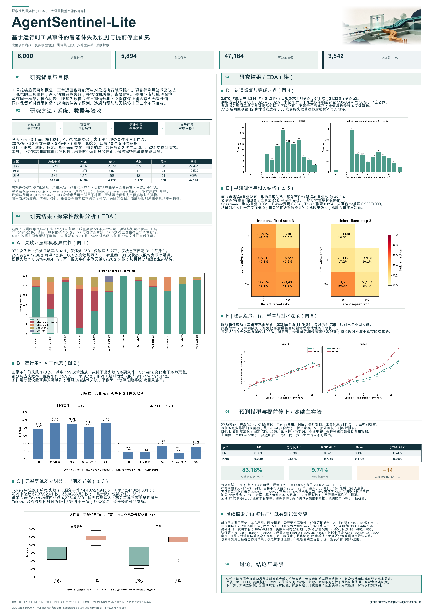
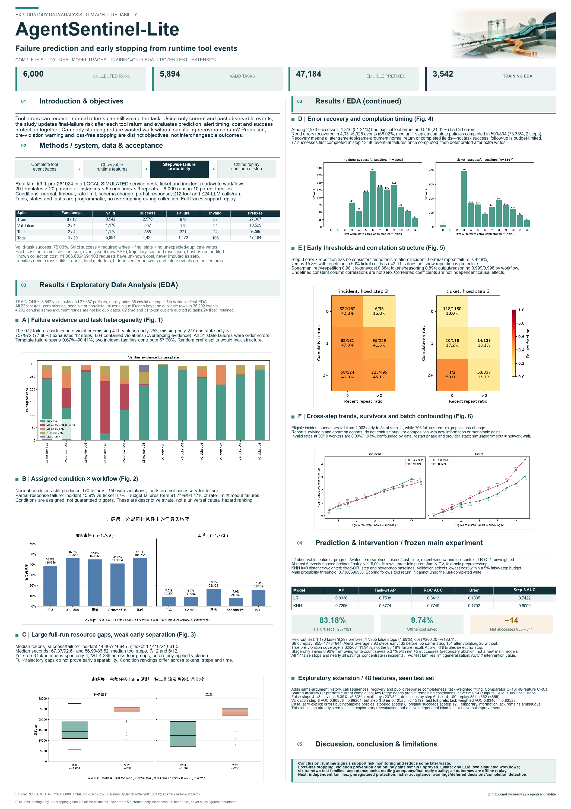

# AgentSentinel-Lite：完整项目 · EDA 重点版海报

这是当前推荐的完整项目版本：采用 A1 竖版双栏、IMRaD 式阅读顺序和带框结论，
覆盖“研究背景 → 数据采集与严格验收 → 探索性数据分析（EDA）→ 冻结 22 项特征主实验
→ 48 项特征后续探索 → 讨论、结论与局限”。EDA 占正文最大篇幅，并完整嵌入六张研究报告原图。

## 成品下载

### 中文主版本

| 用途 | 文件 |
| --- | --- |
| **A1 打印 PDF（推荐提交/打印）** | [AgentSentinel_Complete_EDA_A1_ZH.pdf](./AgentSentinel_Complete_EDA_A1_ZH.pdf) |
| **A1 300 dpi 高清 PNG** | [AgentSentinel_Complete_EDA_A1_ZH.png](./AgentSentinel_Complete_EDA_A1_ZH.png) |
| A0 大幅打印 PDF | [AgentSentinel_Complete_EDA_A0_ZH.pdf](./AgentSentinel_Complete_EDA_A0_ZH.pdf) |
| A1 可编辑 SVG | [AgentSentinel_Complete_EDA_A1_ZH.svg](./AgentSentinel_Complete_EDA_A1_ZH.svg) |
| A0 可编辑 SVG | [AgentSentinel_Complete_EDA_A0_ZH.svg](./AgentSentinel_Complete_EDA_A0_ZH.svg) |
| 轻量预览 | [AgentSentinel_Complete_EDA_A1_ZH_preview.png](./AgentSentinel_Complete_EDA_A1_ZH_preview.png) |

### English edition

| Purpose | File |
| --- | --- |
| A1 print PDF | [AgentSentinel_Complete_EDA_A1_EN.pdf](./AgentSentinel_Complete_EDA_A1_EN.pdf) |
| A1 300 dpi PNG | [AgentSentinel_Complete_EDA_A1_EN.png](./AgentSentinel_Complete_EDA_A1_EN.png) |
| A0 print PDF | [AgentSentinel_Complete_EDA_A0_EN.pdf](./AgentSentinel_Complete_EDA_A0_EN.pdf) |
| A1 editable SVG | [AgentSentinel_Complete_EDA_A1_EN.svg](./AgentSentinel_Complete_EDA_A1_EN.svg) |
| A0 editable SVG | [AgentSentinel_Complete_EDA_A0_EN.svg](./AgentSentinel_Complete_EDA_A0_EN.svg) |
| Lightweight preview | [AgentSentinel_Complete_EDA_A1_EN_preview.png](./AgentSentinel_Complete_EDA_A1_EN_preview.png) |

## EDA 覆盖范围

所有探索性统计与图表只使用 **3,542 条有效训练任务、12 个模板、6 个父任务家族和
27,367 条可决策前缀**；验证集和测试集不进入 EDA。六张原图保持完整内容和原始宽高比：

1. 失败证据构成与模板异质性；
2. 分配运行条件 × 工作流的失败率；
3. 完整任务 Token 分布及全部外点；
4. 成功任务首次严格完成步数；
5. 第 3 步错误与重复的联合失败率热图；
6. 跨步骤错误趋势与存活样本变化。

正文还覆盖缺失值/非有限值检查、时间与 Token 外点审计、错误恢复、早期资源对照、
Spearman 相关结构、存活者偏差以及并发/日期/供应方状态混杂。极高且难以清晰缩放的
Spearman 原图以关键数值和解释代替缩略图。

主实验明确区分冻结 22 项特征模型与后续 48 项特征探索；后者复用已经见过的测试集，
不表述为新的独立盲测。所有停止收益均为离线回放估计，不等同于在线部署收益。

## 打印与编辑

- A1 PDF 页面为 **594 × 841 mm**；A0 PDF 页面为 **841 × 1189 mm**。
- 打印时选择 **100% / 实际大小**，不要“适应页面”二次缩放。
- A1 PNG 为 **7015 × 9933 像素、300 dpi**。
- PDF 嵌入 TrueType 字体；SVG 保留可编辑文字。六张 EDA 图以原始高分辨率图片嵌入，
  不重绘、不改变统计结果。
- A0 版是 A1 设计的等比例放大版，更适合现场张贴和近距离阅读。
- 建议编辑字体为 Arial、Arial Bold 和 Arial Unicode MS；其他系统打开 SVG 时可能需要替换字体。

页首小幅概念插图复用现有 **Seedream 5.5** 作品（返回模型元数据为
`doubao-seedream-5-5-261028`）。本轮没有再次调用图像生成接口；实验图、表格和数字均非 AI 生成。

## 复现与校验

在仓库根目录运行：

```sh
# 快速生成中英文 A1 预览
.venv/bin/python scripts/make_complete_poster.py --preview-only

# 生成全部中英文 A1/A0 PDF、SVG 与 A1 300 dpi PNG
.venv/bin/python scripts/make_complete_poster.py

# 代码规范检查
.venv/bin/ruff check scripts/make_complete_poster.py
```

生成脚本：[`scripts/make_complete_poster.py`](../../../scripts/make_complete_poster.py)。
内容来源：[`docs/RESEARCH_REPORT_6000_FINAL.md`](../../RESEARCH_REPORT_6000_FINAL.md)。

构建程序会核验关键统计、六张原图尺寸、导出页面尺寸、PNG 像素/DPI、PDF 字体嵌入和
SVG 可编辑文字，并在生成前后比较输入 SHA-256。详细证据与成品校验见
[`poster_manifest.json`](./poster_manifest.json)、[`layout_checks.json`](./layout_checks.json)。

## 中文预览



## English preview


