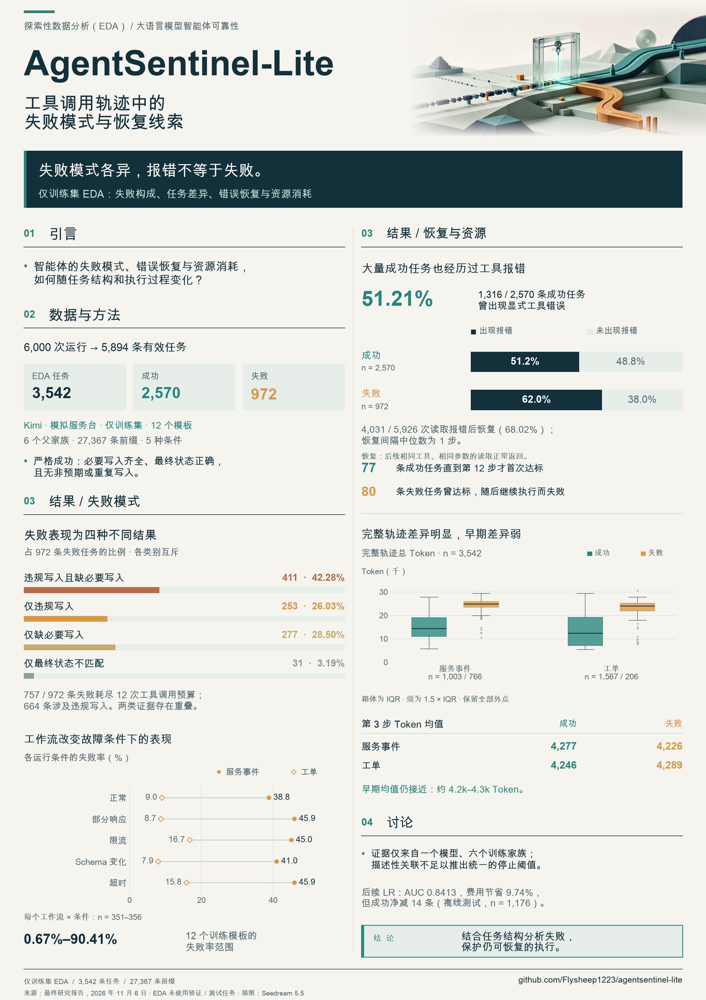
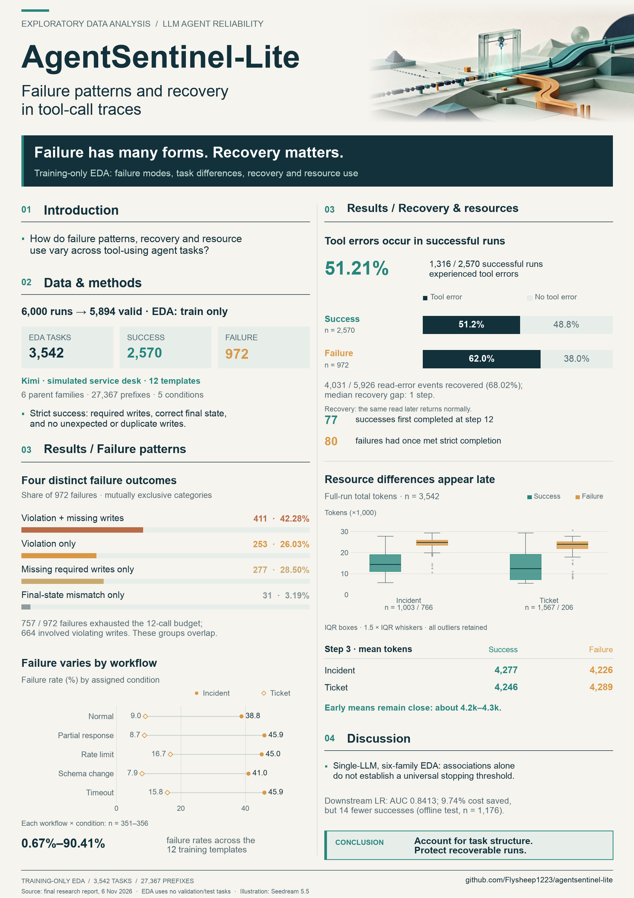

# AgentSentinel-Lite：以 EDA 为主线的海报

本版根据“主要还是得强调 EDA”的要求重新组织，作为当前推荐版本。
保留 A1 竖版双栏、IMRD 结构和带框结论，正文约四分之三用于探索性数据分析。
原预测模型版保留在相邻的 `agentsentinel_a1` 目录。

| 文件用途 | 英文版 | 中文版 |
| --- | --- | --- |
| A1 打印 PDF | [EN.pdf](./AgentSentinel_EDA_A1_EN.pdf) | [ZH.pdf](./AgentSentinel_EDA_A1_ZH.pdf) |
| 300 dpi 高清 PNG | [EN.png](./AgentSentinel_EDA_A1_EN.png) | [ZH.png](./AgentSentinel_EDA_A1_ZH.png) |
| 可编辑 SVG | [EN.svg](./AgentSentinel_EDA_A1_EN.svg) | [ZH.svg](./AgentSentinel_EDA_A1_ZH.svg) |
| 预览 | [EN preview](./AgentSentinel_EDA_A1_EN_preview.png) | [ZH preview](./AgentSentinel_EDA_A1_ZH_preview.png) |

## EDA 主线

1. **失败构成**：972 条失败分为违规且缺必要写入、仅违规、仅缺写入、仅状态不匹配。
   这四类互斥；预算耗尽与违规写入两种证据存在重叠。
2. **任务差异**：五种分配条件下，服务事件与工单的失败率不同；12 个训练模板的失败率
   从 0.67% 到 90.41%。条件图为描述性分组比较，不作因果解释。
3. **恢复与执行时点**：51.21% 的成功任务经历过工具错误；77 条成功任务直到第 12 步才
   首次达标，80 条失败任务曾经达标。错误恢复率以事件为分母，成功比例以任务为分母。
4. **资源分布及早期对照**：完整轨迹 Token 箱线图保留全部外点，旁列第 3 步累计 Token 均值。
   完整轨迹差异不能直接证明早期可分。

所有 EDA 图表均直接来自 **3,542 条有效训练任务**，覆盖 12 个模板、6 个父任务家族和
27,367 条可决策前缀；验证和测试任务没有进入 EDA 图表。
LR 主实验只在讨论末尾保留两行，明确标注为独立的离线测试结果。
隐藏验收字段用于事后描述失败，不作为运行时模型特征。

## 打印与编辑

PDF 页面为 **594 × 841 mm**，嵌入字体，文字及数据图保持矢量；
打印时使用 100% 实际大小。PNG 为 7015 × 9933 像素、300 dpi。
SVG 保留可编辑文字，字体为 Arial 和 Arial Unicode MS。

插图复用之前生成的 Seedream 5.5 概念图，本轮没有再次调用图像生成接口。
正文、图表与实验数字均为单独排版。

```sh
.venv/bin/python scripts/make_eda_poster.py --preview-only
.venv/bin/python scripts/make_eda_poster.py
```

文案与布局在 [`make_eda_poster.py`](../../../scripts/make_eda_poster.py)，
基础绘图函数复用 [`make_research_poster.py`](../../../scripts/make_research_poster.py)。
统计检查、输入 SHA-256 和成品校验值见 [`poster_manifest.json`](./poster_manifest.json)。

## 中文预览



## English preview


