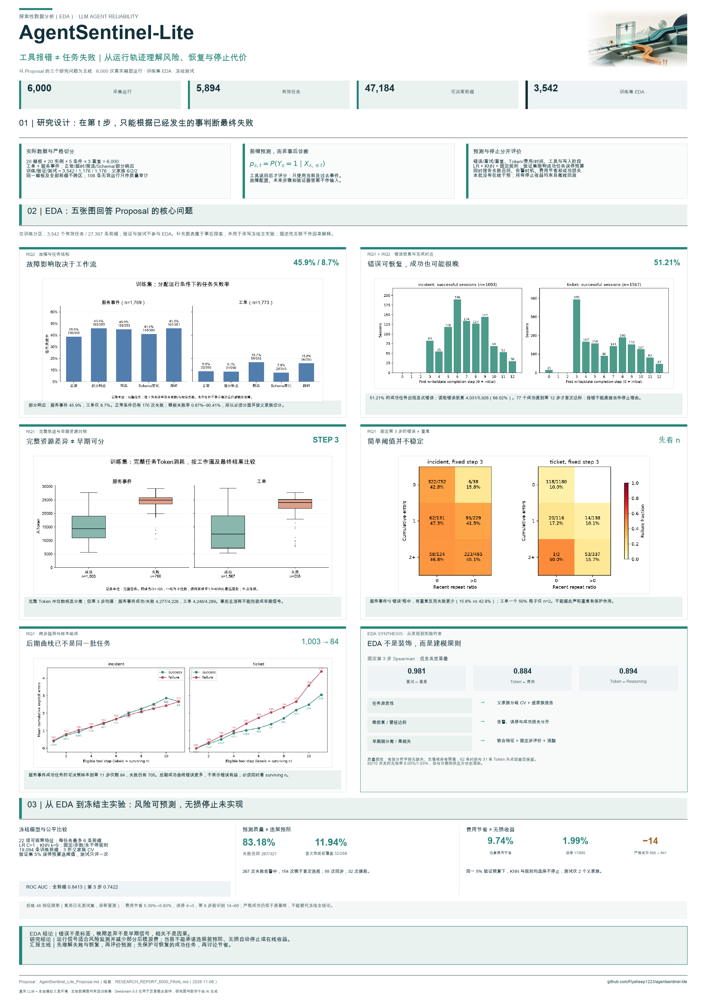

# AgentSentinel-Lite：Proposal 主线 · EDA 证据版海报

本版根据 `AgentSentinel_Lite_Proposal.md` 重新组织，不再按报告章节堆叠内容。
核心叙事是：**工具报错不等于任务失败；完整轨迹差异不等于早期可分；
提前停止可能误伤后来才恢复或完成的任务。**

EDA 图是正文视觉主体，冻结模型实验用于回答这些信号最终能做什么、不能做什么。
此前的 `agentsentinel_complete_eda`、`agentsentinel_eda_a1` 和 `agentsentinel_a1` 版本均保留。

## 成品

### 中文主版本

| 用途 | 文件 |
| --- | --- |
| **A1 打印 PDF（推荐）** | [AgentSentinel_EDA_Story_A1_ZH.pdf](./AgentSentinel_EDA_Story_A1_ZH.pdf) |
| A1 300 dpi PNG | [AgentSentinel_EDA_Story_A1_ZH.png](./AgentSentinel_EDA_Story_A1_ZH.png) |
| A0 大幅打印 PDF | [AgentSentinel_EDA_Story_A0_ZH.pdf](./AgentSentinel_EDA_Story_A0_ZH.pdf) |
| A1 可编辑 SVG | [AgentSentinel_EDA_Story_A1_ZH.svg](./AgentSentinel_EDA_Story_A1_ZH.svg) |
| A0 可编辑 SVG | [AgentSentinel_EDA_Story_A0_ZH.svg](./AgentSentinel_EDA_Story_A0_ZH.svg) |
| 轻量预览 | [AgentSentinel_EDA_Story_A1_ZH_preview.png](./AgentSentinel_EDA_Story_A1_ZH_preview.png) |

### English edition

| Purpose | File |
| --- | --- |
| A1 print PDF | [AgentSentinel_EDA_Story_A1_EN.pdf](./AgentSentinel_EDA_Story_A1_EN.pdf) |
| A1 300 dpi PNG | [AgentSentinel_EDA_Story_A1_EN.png](./AgentSentinel_EDA_Story_A1_EN.png) |
| A0 print PDF | [AgentSentinel_EDA_Story_A0_EN.pdf](./AgentSentinel_EDA_Story_A0_EN.pdf) |
| A1 editable SVG | [AgentSentinel_EDA_Story_A1_EN.svg](./AgentSentinel_EDA_Story_A1_EN.svg) |
| A0 editable SVG | [AgentSentinel_EDA_Story_A0_EN.svg](./AgentSentinel_EDA_Story_A0_EN.svg) |
| Lightweight preview | [AgentSentinel_EDA_Story_A1_EN_preview.png](./AgentSentinel_EDA_Story_A1_EN_preview.png) |

## 与 Proposal 的对应关系

| Proposal 研究问题 | 海报证据 | 实际发现 |
| --- | --- | --- |
| 成功与失败的运行模式有什么不同？ | 完整 Token 箱线图 + 第 3 步均值 | 完整轨迹差异明显，但第 3 步 Token 基本重叠 |
| 故障如何影响任务，哪些能够恢复？ | 条件失败率图 + 成功完成时点图 | 故障影响依赖工作流；51.21% 的成功任务也报错，77 个成功在第 12 步才首次达标 |
| 错误与重复能否形成早期规则？ | 第 3 步二维失败率热图 | 没有稳定单调阈值；必须同时检查每格样本量 |
| 信号是否出现得足够早？ | 跨步错误趋势及 surviving n | 后期样本组成变化显著，不能把存活者偏差解释成错误有益 |
| 哪些特征提供重复信息？ | 固定第 3 步 Spearman 关键值 | 重试/重复、Token/费用、Token/Reasoning 高度相关，不能作独立因果解释 |
| 学习模型能否减少无效开销？ | 冻结 22 特征 LR 与离线回放 | 失败召回 83.18%、估算费用节省 9.74%，但严格成功净减少 14 次 |

另有一张“EDA → 建模规则”综合卡片，将任务异质性、晚恢复、早期弱分离和高相关分别对应到
父家族分组交叉验证、成功损失评价、固定步评价与消融。

## 建议汇报顺序（约 3–5 分钟）

1. **先讲研究对象**：Agent 每次工具返回后，只用已经发生的事件预测整个任务最终是否失败；
   验证器答案和未来信息不进入模型。
2. **再讲第一个反转**：成功任务也经常报错，而且有些成功直到最后一步才出现，所以“报错就停”会误伤。
3. **讲第二个反转**：失败任务最终消耗更多 Token，但第 3 步几乎相同，所以完整轨迹箱线图不是早期预测证据。
4. **讲为什么不能拍脑袋定规则**：热图的小样本格和不稳定方向，以及跨步曲线的存活者偏差。
5. **最后讲模型结果与边界**：风险排序有帮助，但违规前覆盖只有 11.94%；费用节省与成功损失必须一起报告。

一句话收尾：**EDA 让我们把“看起来能停”改写成可检验的“什么时候值得继续、停止会损失什么”。**

## 打印与复现

- A1：594 × 841 mm；A0：841 × 1189 mm。打印选择 **100% / 实际大小**。
- A1 PNG：7015 × 9933 像素、300 dpi；PDF 嵌入字体；SVG 保留可编辑文字。
- 五张研究图保持原图内容与宽高比；页首概念插图复用已有 Seedream 5.5 作品，
  本轮未调用图像生成接口。研究图与数字不是 AI 生成。
- Proposal 的在线对照计划没有在本批执行；海报只报告离线回放结果。
- 48 特征结果明确标为复用已见测试集的后续探索，不作为新的独立盲测。

```sh
# 中英文轻量预览
.venv/bin/python scripts/make_eda_story_poster.py --preview-only

# 全部 A1/A0 成品
.venv/bin/python scripts/make_eda_story_poster.py

# 静态检查
.venv/bin/ruff check scripts/make_eda_story_poster.py
```

生成脚本：[`scripts/make_eda_story_poster.py`](../../../scripts/make_eda_story_poster.py)。
Proposal：[`AgentSentinel_Lite_Proposal.md`](../../../AgentSentinel_Lite_Proposal.md)。
结果来源：[`docs/RESEARCH_REPORT_6000_FINAL.md`](../../RESEARCH_REPORT_6000_FINAL.md)。
统计、输入哈希及成品校验见 [`poster_manifest.json`](./poster_manifest.json)。

## 中文预览


